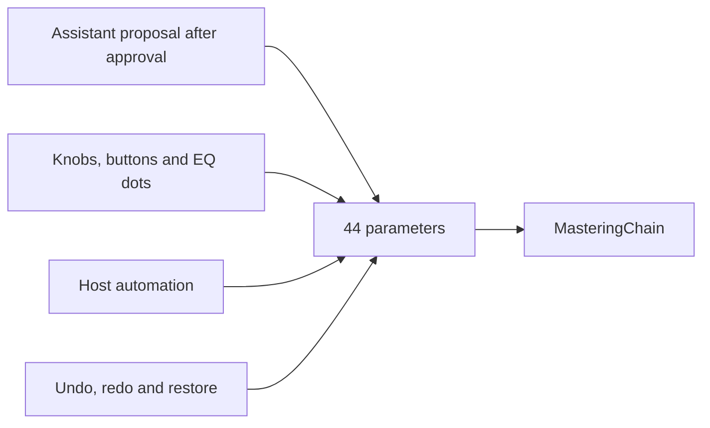
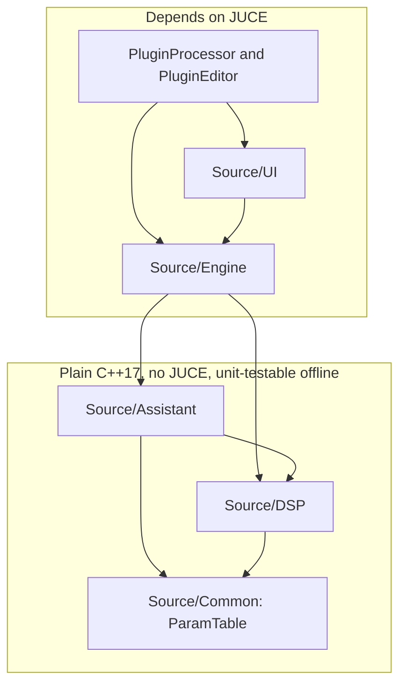
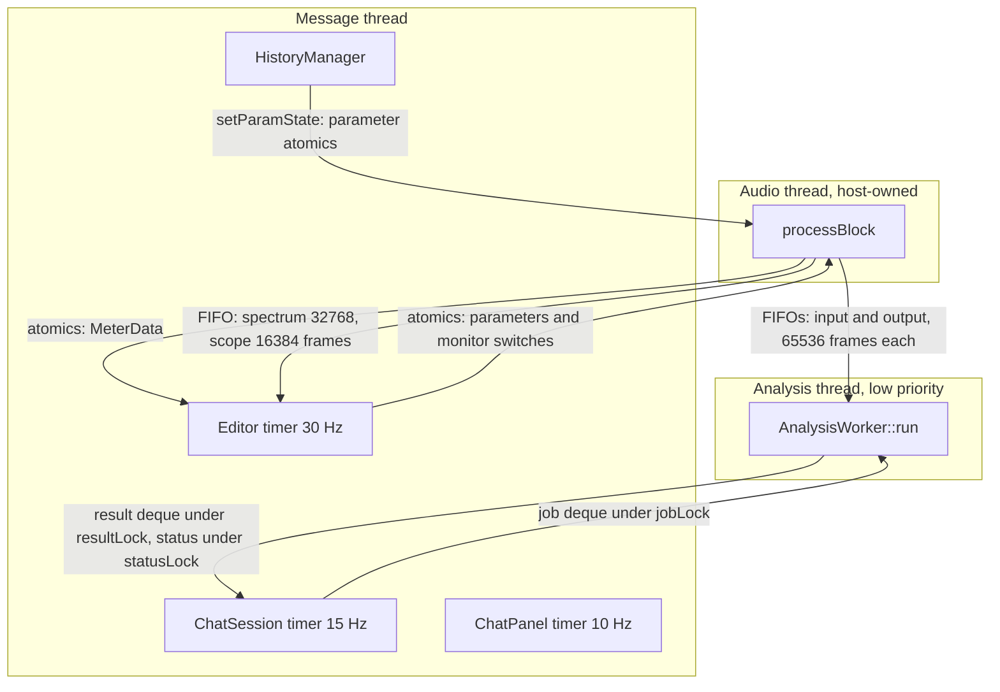
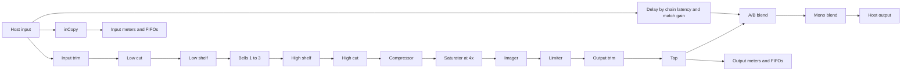
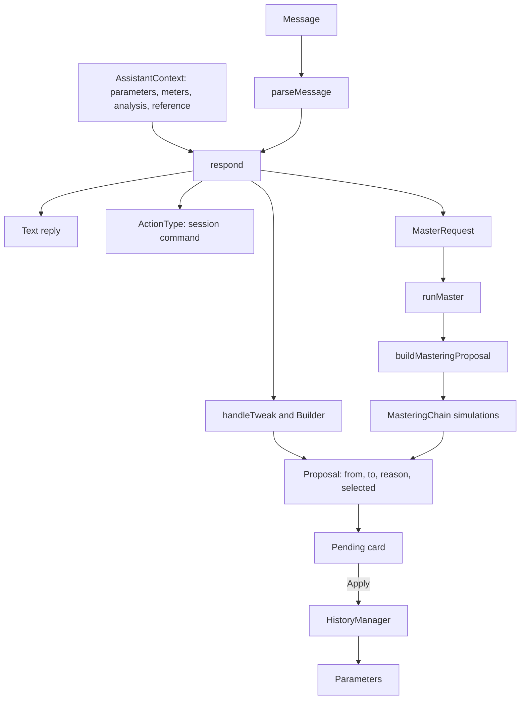
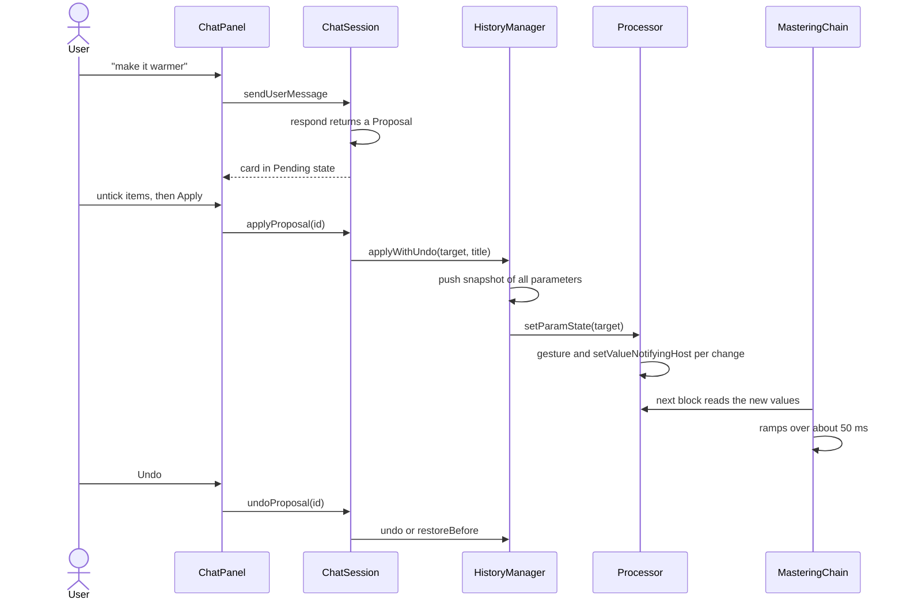
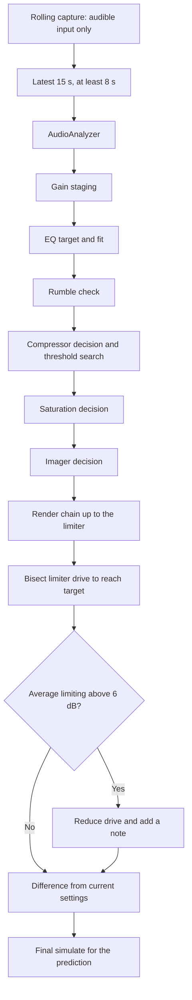
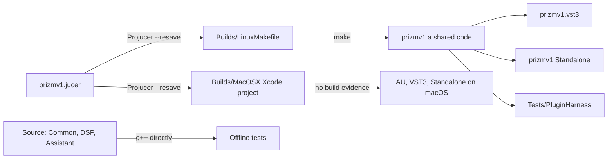

# PRIZM V2: Architecture and Technical System Overview

Status as of 2026-11-01, version 2.0.0. Paths are relative to `prizmv1/`. For full explanations, see `PRIZM_V2_COMPLETE_REPORT.md`.

## 1. System summary

PRIZM V2 is a stereo or mono JUCE audio effect, with these parts:

- A fixed five-module mastering chain plus trims and a monitoring stage.
- BS.1770 and EBU R128 metering, plus true-peak and stereo measurement.
- A rule-based, local assistant whose output is data (proposals) rather than direct action.
- A background thread for file analysis and offline simulation.

**Core design principle.** Everything converges on one set of 44 parameters. The assistant, manual controls, host automation and undo all write to them, and the DSP only reads them.

## 2. Layers and dependencies

| Layer | Lines | Depends on JUCE? | Tested by |
|---|---|---|---|
| `Source/Common` | 284 | No | Offline tests |
| `Source/DSP` | 3,093 | No (verified by search) | Offline tests |
| `Source/Assistant` | 2,983 | No (verified by search) | Offline tests |
| `Source/Engine` | 1,499 | Yes | Harness only |
| `Source/UI` | 3,364 | Yes | Harness only; display content isn't checked automatically |
| `PluginProcessor`, `PluginEditor` | 1,088 | Yes | Harness only |

## 3. Runtime threads

| Thread | Allowed | Forbidden, by design |
|---|---|---|
| Audio | DSP, atomics, FIFO push, stack and preallocated memory | Locks, heap allocation, file I/O, UI |
| Analysis | File reads, heap, long simulations, locks on its own queues | Touching the live chain or UI |
| Message | UI, parameters, chat, history, FFT for the display | Touching the live chain's objects directly |

These rules were established by code review. No real-time sanitizer has been run.

**Overflow behaviour.** If a FIFO is full, audio for display or analysis is dropped, and the output is never affected. `pushAudio` writes the same frame count to both worker FIFOs, so that input and output stay aligned.

## 4. Audio signal path

Host blocks are split to at most 2048 samples in `processBlock`, then to at most 512 in `MasteringChain`. All switches crossfade.

**Latency budget**, constant in every state (**Measured**):

| Component | Samples at 48 kHz |
|---|---|
| Oversampler round trip | 59 |
| Limiter lookahead, 2 ms | 96 |
| True-peak detector | 6 |
| **Total** | **161 (3.35 ms)** |

A disabled module's signal still follows a matching delay path. The saturator and limiter run all the time, so CPU use barely depends on which modules are on: 1.6% with all off and 1.8% with all on, on this machine at 48 kHz (**Measured**, DSP only).

## 5. Assistant architecture

**Classification:** rule-based parsing, hand-written recipes, threshold rules and numerical search. There's **no trained model**, no network access, and no learning. Output is deterministic for a given message and state.

**Boundary.** `respond` receives parameters as read-only values and returns a `Reply`. It has no reference to the processor, so it can't change the sound. This boundary is what enforces the approval rule, and a future language model could replace the parser without changing it.

## 6. Proposal lifecycle

## 7. Mastering proposal pipeline

## 8. State and persistence

| Data | Owner | Lifetime | Saved in session? |
|---|---|---|---|
| 44 parameters | `apvts` | Plugin instance | **Yes** |
| Target LUFS, ceiling target | Processor | Plugin instance | **Yes** |
| Reference name, path, analysis | Processor | Plugin instance | **Yes**, as a serialised string |
| Reference audio | None | Never kept | No |
| A/B, level match, mono | Processor | Plugin instance | No; defaults to Processed, match on, mono off |
| Undo history, up to 100 snapshots | `HistoryManager` | Plugin instance | No |
| Chat, up to 200 messages | `ChatSession` | Plugin instance; survives closing the window | No |
| Recent analyses | `ChatSession` | Plugin instance | No |
| Rolling capture, 20 s | `AnalysisWorker` | Until stale or rate change | No |

`getStateInformation` writes the APVTS XML plus a `PRIZM_V2` child element, which `setStateInformation` reads and removes before restoring.

## 9. Build and deployment

- `prizmv1/Builds/` is untracked in git.
- The Makefile copies the VST3 to `~/.vst3` unless `JUCE_VST3DESTDIR=` is set empty.
- The installed `~/.vst3` copy on this machine is V1 (1.0.0).
- Plugin identity is still the placeholder: name `prizmv1`, manufacturer `yourcompany`, codes `Manu` and `Mpkc` (shown in hexadecimal in `JuceLibraryCode/JucePluginDefines.h`).

## 10. Architecture strengths and risks

| Strength | Why it matters |
|---|---|
| One DSP engine for live and simulation | Predictions reflect the real chain. Prediction and live output agreed within about 0.12 LU (**Simulated**) |
| Assistant as a pure function | Testable; can't change the sound without approval |
| Single parameter table | Host, DSP, UI and assistant can't disagree |
| No locks on the audio path | Reader problems can't delay audio |
| Fixed latency | Simple for hosts; A/B stays aligned |

| Risk | Detail | Suggested change |
|---|---|---|
| Monitoring is in the output path | A/B and Mono print to a bounce | Warn, or disable when `isNonRealtime` is true |
| Chat card state is separate from history | Cards can show stale state | Derive card state from history IDs |
| Single job queue with no cancellation path | A waiting job blocks others | Add a Cancel button and a busy check |
| Gain reduction read after chunked processing | Under-reads above 512-sample blocks | Hold a per-call maximum in the chain |
| Analysis of only 15 s | Prediction may not reflect the whole song | Offer a whole-song capture |
| Static single-band chain | No targeted fixes | Multiband modules with crossovers |
| Never run in a real host | The host boundary is the largest unverified area | DAW and validator testing first |
