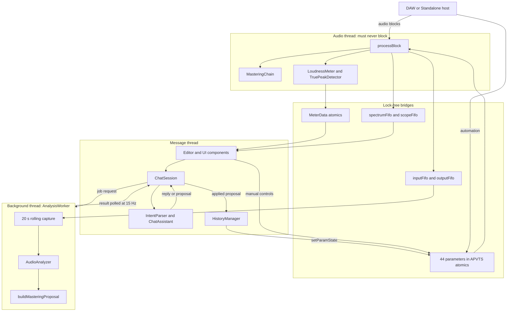
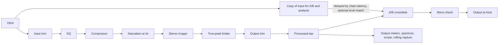
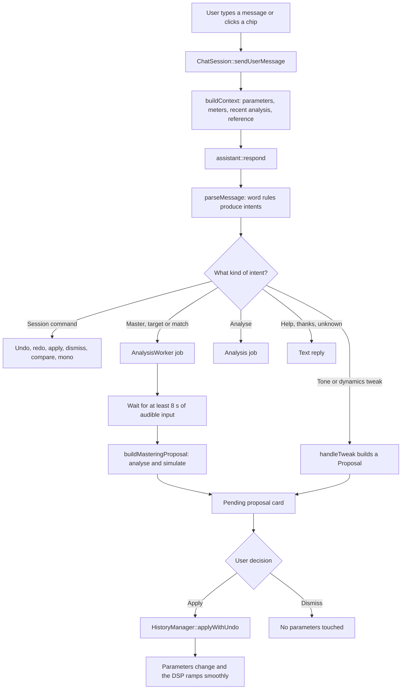
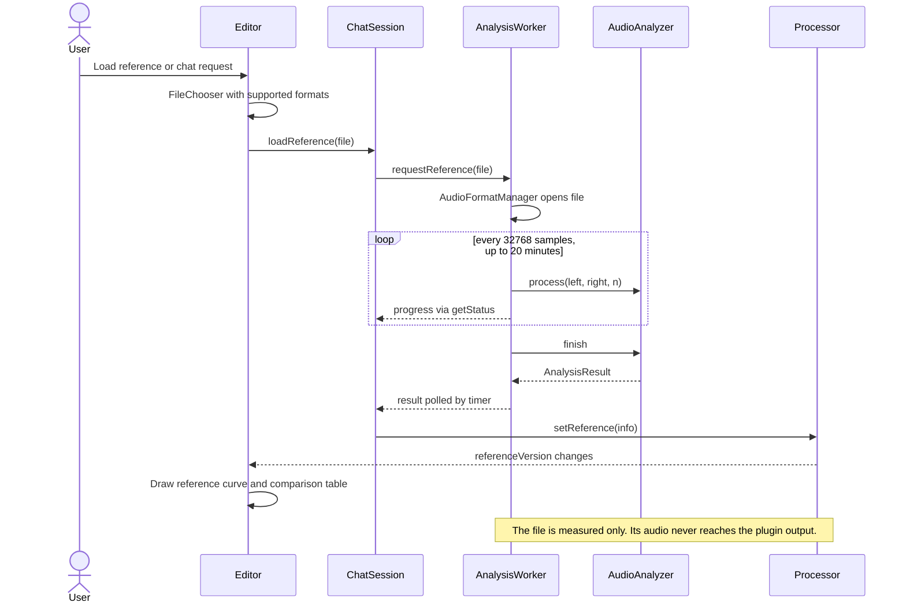
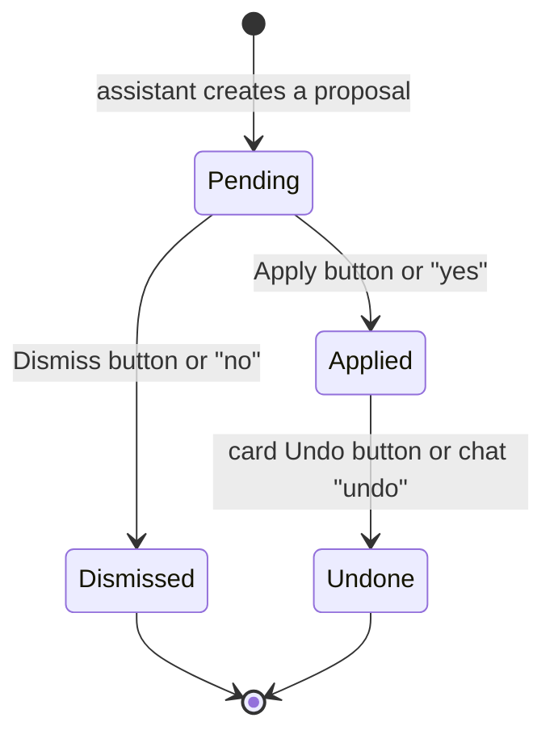

# PRIZM V2: Complete Technical and Project Documentation

| | |
|---|---|
| **Product** | PRIZM V2, an assistant-driven mixing and mastering audio plugin |
| **Version inspected** | 2.0.0 (`prizmv1.jucer`), commit `fd9f197` on branch `Jaswanth` |
| **Report date** | 2026-11-01 |
| **Formats** | VST3 and Standalone built on Linux; an AU target is configured for macOS but no macOS build was found |
| **Code size** | about 12,300 lines in `Source/`, 1,400 lines in `Tests/` |

## How to read this report

**Two audiences.** Each major feature has a **Simple explanation** for people who know music but not code, and a **Technical explanation** for engineers. If you don't read code, Chapters 1, 2, 8, 10 and 14 are written for you, and you can skip the code blocks everywhere else.

**Paths.** Every source path is relative to the project folder `prizmv1/`. A citation such as `Source/DSP/Limiter.cpp:104-163` means lines 104 to 163 of that file.

**Code excerpts.** Excerpts were copied from the source by a script rather than typed by hand. A `// ...` line marks skipped code, and blank lines inside a range are kept. In Chapter 6 the numbers on the left are the real file line numbers.

**How much to trust each claim.** The report separates four kinds of evidence:

| Label | Meaning |
|---|---|
| **Measured** | Produced by running code during this inspection (2026-11-01) |
| **Simulated** | Measured by running the real plugin code against a generated test signal and an artificial audio thread, with no DAW involved |
| **Code-verified** | Established by reading the implementation, not by running it |
| **Not tested** | No evidence exists either way |

**Where the facts came from.** The source code was read first, and the older documents were checked against it. Three older documents exist:

- `docs/PRIZM_V2_DESIGN.md` is mostly accurate. Its measured figures were re-run, and Section 11.5 lists where it needs qualifying.
- `readme.txt` (identical to the top-level `PRIZM_README.txt`) describes V1 and is out of date. For example, it lists a working DSP chain, while the V1 backup's `processBlock` only reads levels.
- The top-level slide deck `PRIZM_AI_Audio_Assistant.pptx` is labelled "Phase 1 Prototype" and describes V1. It mentions `juce::dsp::Compressor` and a planned OpenRouter connection. Neither appears anywhere in V2's code.

**Screenshots.** The only committed image, `pics/6th.jpeg`, shows **V1** running in Logic, so it isn't used to illustrate V2. Section 10.1 explains how to generate real V2 screenshots.

---

# Chapter 1: Project Overview

## 1.1 What is PRIZM?

PRIZM is an audio plugin that you place on a track or master bus in a music program (a DAW, or digital audio workstation). It has two halves:

1. **A real mastering chain:** equaliser, compressor, saturation, stereo imager and limiter, plus professional loudness meters.
2. **A chat assistant:** you type something like "make it warmer" or "master it for Spotify". PRIZM answers with a list of exact settings it wants to change and why. Nothing changes until you approve it.

## 1.2 Why was it developed?

`readme.txt` states the original aim: reducing the barrier to professional mixing and mastering for independent artists, producers and students who can't hire an engineer. It names five problems: the knowledge barrier, the cost of expertise, tool complexity, lack of guidance, and the risk of damaging audio with unconstrained automatic processing.

V2 exists because V1 didn't deliver this. The V1 backup (`prizmv1_V1_backup_2026-10-28.tar.gz`) has a `processBlock` that only reads levels, so V1's "Applied: +4.0dB high shelf" chat replies changed nothing in the sound. V2 replaced this with real processing.

## 1.3 What problem does it solve?

A beginner can often describe what they hear ("it sounds muddy") but not what to do about it ("cut 2 dB around 300 Hz with a Q of 1.2"). PRIZM bridges that gap, and it shows its reasoning so that you learn from it:

- It turns descriptions into specific parameter changes.
- It explains each change in plain words.
- It measures loudness to broadcast standards, so "how loud is it?" has a real answer.
- It tests a mastering proposal on your audio before you hear it, and predicts the resulting loudness.
- It keeps every decision reversible.

## 1.4 Who is it for?

- **Primary:** independent producers, home-studio musicians and students who need a finished, release-ready sound without a mastering engineer.
- **Secondary:** experienced engineers who want quick starting points. All 44 parameters can be automated by the host and adjusted by hand.

## 1.5 What makes it different from traditional tools?

| Traditional plugin | PRIZM V2 | Evidence |
|---|---|---|
| You must already know which knob to turn | You describe the result, and it proposes the knobs | `Source/Assistant/ChatAssistant.cpp:138-557` |
| "Auto" buttons often change settings directly | Every suggestion is a card with before and after values, a reason, a tick box per change, and Apply and Dismiss buttons | `Source/UI/ChatPanel.cpp:369-468` |
| Louder-sounding often seems better when comparing | The A/B switch can play the original at the same loudness as the processed sound | `Source/PluginProcessor.cpp:363-366` |
| Target loudness is reached by trial and error | The limiter drive is found by simulating the whole chain on your audio | `Source/Assistant/MasteringAssistant.cpp:707-754` |
| Some AI tools rely on online services | Runs entirely on your computer, with no network code in `Source/` | Search of `Source/` found no network calls |

It's also important to be clear about what PRIZM is not. It does not use a trained AI model. Its "AI" is a rule-based language parser combined with signal analysis and a numerical search, as Chapter 8 explains. No comparison against commercial tools or mastering engineers has been carried out, and no human listening tests are on record.

## 1.6 The whole idea in simple language

Think of PRIZM as a careful assistant in a mastering studio. You play your song and say what you'd like. The assistant listens to about 15 seconds, measures it, works out a set of adjustments and tries them privately on a copy of the audio. It then hands you a written list saying "I'd like to change these 16 settings, for these reasons, and I expect the result to be -14 LUFS". You can cross items off, accept or reject the list. You can flip between before and after at matching volume, and undo anything later.

## 1.7 Short technical overview

PRIZM V2 is a C++17 JUCE 8.0.12 audio effect with 44 host-automatable parameters, stored in an `AudioProcessorValueTreeState`. The code has clear layers:

- **Plain C++ layers:** `Source/DSP`, `Source/Assistant` and `Source/Common` don't depend on JUCE and can be unit tested offline.
- **Live audio:** `Prizmv1AudioProcessor::processBlock` runs the chain without taking locks or allocating memory, and publishes meters through atomics and audio through lock-free FIFOs.
- **Background thread:** `AnalysisWorker` keeps a rolling 20-second capture, analyses reference files and runs offline simulations.
- **Message thread:** the editor, `ChatSession` and `HistoryManager`.
- **Chain latency:** fixed at 161 samples at 48 kHz (**Measured**) and reported to the host, whichever modules are on.

---

# Chapter 2: Audio Engineering Fundamentals

Each concept below has a simple explanation, a music example, and how PRIZM uses it.

## 2.1 Audio signals and digital audio processing

**Simple explanation.** Sound is air pressure moving back and forth. A computer stores it as a long list of numbers, each recording the pressure at one instant. Digital processing means doing arithmetic on those numbers. Multiplying them all by 2 makes the sound louder.

**Music example.** When a singer's voice is recorded, the microphone's signal becomes tens of thousands of numbers per second. Turning the vocal down in a mix multiplies all of them by a number below 1.

**How PRIZM uses it.** Audio arrives as 32-bit floating-point numbers in `processBlock`. Full scale is ±1.0. The DSP code does arithmetic on each number, using 64-bit values inside the filters for accuracy (`Source/DSP/Biquad.h:127-135`).

## 2.2 Sample rate and buffer size

**Simple explanation.** *Sample rate* is how many numbers per second describe the sound. 48,000 per second (48 kHz) is common. *Buffer size* is how many numbers the DAW hands over at once. Smaller buffers respond faster but give the computer less time to finish each batch.

**Music example.** At 48 kHz with a 512-sample buffer, the plugin gets a new batch about every 10.7 ms and must finish each one in that time, or you hear a click.

**How PRIZM uses it.** `prepareToPlay` rebuilds all filters and timings for the actual sample rate. Host blocks of any length are split into pieces of at most 2048 samples and then 512 samples, so nothing allocates at run time (`Source/PluginProcessor.cpp:331-333`, `Source/DSP/MasteringChain.cpp:139-142`). With static settings, output was bit-identical at block sizes 64, 480 and 2048 (**Measured**).

## 2.3 Frequency spectrum

**Simple explanation.** Any sound can be described as a mixture of pitches, from low (bass) to high (cymbals). The spectrum shows how much energy each pitch region has. People hear from about 20 Hz to 20,000 Hz.

**Music example.** A kick drum lives mostly around 50 to 100 Hz, vocal clarity around 2 to 5 kHz, and the "air" on a cymbal above 10 kHz.

**How PRIZM uses it.** A live spectrum display shows input, output, reference and EQ curves (`Source/UI/SpectrumDisplay.cpp:82-124`). The analyser also measures a long-term spectrum at 64 points and six named bands, used for all tonal decisions (`Source/DSP/AudioAnalyzer.cpp:20-21`).

## 2.4 RMS and peak levels

**Simple explanation.** *Peak* is the single highest moment of a signal. *RMS* is a kind of average of its strength over a short time, closer to how loud it seems.

**Music example.** A snare hit has a high peak but is over quickly. A sustained distorted guitar can have a lower peak but a higher RMS, and so sound louder.

**How PRIZM uses it.** The IN and OUT meters show both, with RMS smoothed over about 300 ms (`Source/PluginProcessor.cpp:213-235`). The compressor's detector also uses a 5 ms RMS-style measurement (`Source/DSP/Compressor.cpp:128-129`).

## 2.5 LUFS and loudness measurement

**Simple explanation.** LUFS measures how loud a track *sounds* to people, not just how strong the signal is. It weights frequencies the way hearing does and ignores silences. Numbers are negative, and closer to zero means louder. One LU is a 1 dB change.

**Music example.** Two songs can both peak at maximum yet differ by 6 LUFS, because one is heavily compressed. Streaming services use LUFS to decide how much to turn each song down.

**How PRIZM uses it.** `LoudnessMeter` implements ITU-R BS.1770-4 and EBU R128 with momentary (400 ms), short-term (3 s) and integrated readings, and loudness range. It passed the EBU reference cases tested in Chapter 11. The chat has built-in targets such as Spotify at -14 LUFS, listed in `Source/Assistant/IntentParser.cpp:407-426`. Those targets are the project's chosen values, and platform policies can change, so check current platform guidance before release.

## 2.6 True peak and clipping

**Simple explanation.** *Clipping* happens when a signal goes above the maximum level, which flattens the wave and causes distortion. *True peak* catches peaks that fall between stored samples. These only appear when the audio is converted back to analogue or encoded as MP3 or AAC.

**Music example.** A loud master that never exceeds 0 dBFS in its samples can still distort on a phone after streaming encoding. A ceiling of -1 dBTP gives a safety margin.

**How PRIZM uses it.** `TruePeakDetector` estimates four points per sample (`Source/DSP/TruePeak.h:36-54`). The limiter can use this to hold the ceiling, and the meter shows the highest true peak so far. With 12 dB of drive and a -1 dB ceiling, true peak measured -0.999 dBTP (**Measured**).

## 2.7 Dynamic range and crest factor

**Simple explanation.** *Dynamic range* is the difference between loud and quiet. *Crest factor* is how far peaks stand above the average level. A big crest factor sounds punchy and open, a small one dense and loud.

**Music example.** An orchestral recording may have a large loudness range. A modern pop chorus has a small one, with peaks barely above the average.

**How PRIZM uses it.**

- **Loudness range (LRA)** is measured to EBU Tech 3342 and shown live.
- **PLR** (true peak minus integrated loudness) is the main density measure used by the assistant.
- **Crest factor** is calculated (`crestDb` in `Source/DSP/AudioAnalyzer.cpp:354`) but isn't shown or used anywhere. PLR does that job instead.
- There is no dedicated "DR" meter.

## 2.8 Equalisation (EQ)

**Simple explanation.** EQ turns specific pitch regions up or down, like a much more precise bass and treble control.

**Music example.** Cutting a little around 300 Hz often reduces "mud". A gentle lift above 10 kHz adds "air".

**How PRIZM uses it.** A seven-section equaliser: low cut, low shelf, three bells, high shelf and high cut (`Source/DSP/ParametricEQ.h:6-7`). The assistant sets it from your request, and the display lets you drag its points.

## 2.9 Compression

**Simple explanation.** A compressor automatically turns the sound down when it gets loud, making the level more even. *Threshold* is where it starts, *ratio* how strongly it acts, and *attack* and *release* how fast it reacts and recovers.

**Music example.** Slowing the attack lets the initial hit of drums through before the compressor reacts, which can make them sound punchier.

**How PRIZM uses it.** A single-band, stereo-linked compressor (`Source/DSP/Compressor.cpp:95-149`). "Punchier" uses a 20 ms attack. Mastering proposals only add compression when measurements show a need.

## 2.10 Saturation

**Simple explanation.** Saturation gently rounds off the tops of waves, as analogue tape and tubes do. This adds new related pitches (harmonics) that can sound warm and full.

**Music example.** A clean bass on a phone speaker can vanish, but added harmonics make it audible because small speakers can reproduce them.

**How PRIZM uses it.** Tape, Tube and Soft Clip curves, processed at four times the sample rate so that added harmonics don't fold back as unwanted tones (`Source/DSP/Saturator.cpp:26-48`).

## 2.11 Limiting

**Simple explanation.** A limiter is a very fast, very strict compressor that sets an absolute ceiling on level. Turning the music up into it makes the track louder while peaks stay below the ceiling.

**Music example.** Almost every commercial pop master uses a limiter as the last step. Pushing it too far makes drums lose their impact.

**How PRIZM uses it.** A true-peak lookahead limiter near the end of the chain (`Source/DSP/Limiter.cpp:104-163`). The mastering assistant searches for the drive needed to reach a loudness target, and stops at about 6 dB of average limiting.

## 2.12 Stereo imaging

**Simple explanation.** Stereo can be split into *mid* (what's the same in both speakers) and *side* (what's different). Turning up side makes the sound wider. Low frequencies are usually kept in the middle to stay solid.

**Music example.** Wide backing vocals and a centred kick and bass are a classic pop layout.

**How PRIZM uses it.** `StereoImager` scales the side signal from 0% to 200%, and can make everything below a chosen frequency mono (`Source/DSP/StereoImager.cpp:73-90`).

## 2.13 Phase correlation and the stereo vectorscope

**Simple explanation.** *Correlation* shows how similar left and right are: +1 is identical (mono), 0 is unrelated, and negative means they partly cancel when played on one speaker. A *vectorscope* draws this as a shape. A vertical line is mono, and a wide cloud is wide stereo.

**Music example.** A widening effect can sound impressive on headphones but make a guitar nearly disappear on a mono phone speaker. Negative correlation warns you about this.

**How PRIZM uses it.** Both the live meters and the analyser measure correlation (`Source/PluginProcessor.cpp:261-271`, `Source/DSP/AudioAnalyzer.cpp:356`). The vectorscope and correlation bar are in `Source/UI/Meters.cpp`. The assistant refuses to widen further when correlation is below 0.2 (`Source/Assistant/ChatAssistant.cpp:455-460`), and a Mono button lets you check by ear.

---

# Chapter 3: System Architecture

**Simple explanation.** PRIZM does three jobs at once and keeps them separate. One part handles the music and must never be late. Another does heavy thinking in the background. The third is the screen you interact with. They exchange messages in ways that can't make the music stutter, even if the screen or the thinking falls behind.

**Technical explanation.** The system uses three kinds of thread with one-way, non-blocking data flow from the audio thread. Everything is parameter-driven: the assistant, manual controls, host automation and undo all change the same 44 parameters, and the DSP reads only those values.

## 3.1 High-level architecture



## 3.2 Audio signal flow

**Simple explanation.** Audio runs through the modules in a fixed order, like pedals on a pedalboard. Modules that are off still pass the audio through, delayed by the same amount, so everything stays lined up.



The EQ's internal order is low cut, low shelf, three bells, high shelf, high cut (`Source/DSP/ParametricEQ.cpp:192-205`). Meters read the processed tap, *before* the A/B stage, so they always describe the processed sound, even while you're listening to the original. The panel shows "METERING PROCESSED SIGNAL" during this (`Source/UI/Meters.cpp:304-309`).

## 3.3 AI assistant workflow



## 3.4 Reference-track analysis workflow



## 3.5 User interaction and proposal states

A proposal card moves through these states (`Source/Engine/ChatSession.h:25`):



Section 12.3 describes a gap here: the **header** Undo and Redo buttons change the sound without updating these card states.

## 3.6 Modules and how they communicate

| Module | Responsibility | Communicates through |
|---|---|---|
| `Source/Common` | One table defining all 44 parameters | Compiled into all other layers |
| `Source/DSP` | All signal processing and measurement | Direct calls; no threads or JUCE |
| `Source/Assistant` | Language parsing, proposals, simulations | Pure functions returning `Reply` or `Proposal` values |
| `Source/Engine` | Threads, FIFOs, session and history | Atomics, FIFOs, a few locks away from audio, `ChangeBroadcaster` |
| `Source/UI` | Everything on screen | Reads processor state on timers; parameter attachments |
| `PluginProcessor` | Owner of all the above, and the audio callback | Host API |
| `PluginEditor` | Layout and the 30 Hz update timer | Pulls meter and FIFO data |

**Thread-communication rules** (**Code-verified**):

| From → to | Mechanism | Blocks audio? |
|---|---|---|
| UI or host → audio: parameters | `std::atomic<float>` via APVTS raw values | No |
| UI → audio: A/B, mono, level match, meter reset | `std::atomic<bool>` | No |
| Audio → UI: meter numbers | `MeterData` relaxed atomics | No |
| Audio → UI: waveform data | `AudioFifo` (`juce::AbstractFifo`) | No; audio is dropped if full |
| Audio → worker: captured audio | Two `AudioFifo`s kept in step | No; audio is dropped if full |
| Message → worker: jobs | `std::deque` under `jobLock` | Audio thread never touches it |
| Worker → message: results, status | `resultLock` and `statusLock`, polled at 15 Hz | Audio thread never touches them |
| Message ↔ reference data | `referenceLock` | Audio thread never touches it |

---

# Chapter 4: Technology Stack

Only technologies with evidence in the project are listed. The project doesn't record why each was chosen, so "reason" below is what the code and design document show.

| Technology | What it is | Reason | Where used | Role |
|---|---|---|---|---|
| **C++17** | Programming language | Predictable real-time performance, and the language JUCE requires | Everywhere; `cppLanguageStandard="17"` in `prizmv1.jucer:5` | Implementation language |
| **JUCE 8.0.12** | Framework for audio plugins and apps | One codebase for plugin formats and GUI; V1 was already built on it | Bundled in `../juce-8.0.12-linux/JUCE` | Host integration, GUI, threads, file decoding |
| **Projucer** | JUCE's project generator | Generates Makefile and Xcode project from one file | `prizmv1.jucer` | Build configuration |
| **GNU Make and g++** | Linux build tools | Output of the Projucer Linux exporter; g++ 13.3.0 on this machine | `Builds/LinuxMakefile/Makefile` | Linux builds and tests |
| **Xcode project** | macOS build files | Targets macOS hosts such as Logic, through the AU format | `Builds/MacOSX/prizmv1.xcodeproj` | macOS builds (no build evidence) |
| **VST3 SDK 3.8.0** | Plugin standard | Bundled with JUCE; version from generated `moduleinfo.json` | JUCE plugin client | VST3 format |
| **Audio Unit** | Apple plugin standard | Target enabled by `JucePlugin_Build_AU` | macOS only | Logic compatibility (untested for V2) |
| **Custom radix-2 FFT** | Frequency analysis | Generalised from V1's hand-written FFT; works with no JUCE dependency | `Source/DSP/FFT.h` | Spectrum, analysis |
| **Custom DSP in plain C++** | Filters, compressor, limiter, oversampler, meters | Testable offline, and reused by the worker for simulations | `Source/DSP/` | The audio engine |
| **Custom test harness** | Small test macros | No dependency needed | `Tests/TestHarness.h` | Offline tests |
| **Bash scripts** | Test runners | Simple build-and-run | `Tests/run_tests.sh`, `Tests/run_plugin_harness.sh` | Testing |

**JUCE modules** (`prizmv1.jucer:133-145`) and what PRIZM uses them for:

| Module | Used for |
|---|---|
| `juce_audio_processors`, `juce_audio_processors_headless`, `juce_audio_plugin_client` | Plugin base class, parameters, VST3, AU and Standalone wrappers |
| `juce_audio_basics` | `AudioBuffer`, `AbstractFifo` (via `juce_core`), `ScopedNoDenormals` |
| `juce_audio_formats` | Decoding reference files |
| `juce_audio_devices`, `juce_audio_utils` | Standalone audio device support |
| `juce_core`, `juce_events`, `juce_data_structures` | Threads, timers, strings, XML state, change broadcasters |
| `juce_graphics`, `juce_gui_basics`, `juce_gui_extra` | The whole interface |

**Libraries required to build on Linux** (from `Builds/LinuxMakefile/Makefile`): ALSA, FreeType, Fontconfig, libcurl, WebKit2GTK and GTK3. These are required by the JUCE modules. libcurl and WebKit are compiled in, but PRIZM's own code never makes a network request or opens a web view.

**What is *not* used, despite older documents or common assumptions:**

| Not used | Evidence |
|---|---|
| `juce_dsp` module and `juce::dsp::Compressor` (named in the slide deck) | Not in the module list; no `juce::dsp` in `Source/` |
| Any machine-learning library or model | No ONNX, TensorFlow, PyTorch or llama references in `Source/` or `Tests/` |
| OpenRouter or any cloud API | No HTTP, URL or socket use in `Source/` |
| CMake for this project | No `CMakeLists.txt` in `prizmv1/`. The one in the JUCE folder is JUCE's own |
| Third-party DSP libraries | None; all algorithms are in `Source/DSP` |
| A Windows build target | `prizmv1.jucer` has only `LINUX_MAKE` and `XCODE_MAC` exporters |

**Licensing note.** JUCE is dual-licensed under AGPLv3 and a commercial licence (`../juce-8.0.12-linux/JUCE/LICENSE.md`). Any public or commercial release must comply with one of them. The repository doesn't state which applies, so this needs a decision before distribution.

---

# Chapter 5: Complete Source Code Explanation

This chapter covers each file's job and connections. Chapter 6 walks through the most important functions line by line.

**Simple explanation.** Think of a band's road crew. One person handles the signal chain, another the meters, another talks to the artist. Each source file below has a defined job like that.

**Line counts.** `Source/` holds about 12,300 lines: top level 1,088, `Common` 284, `DSP` 3,093, `Assistant` 2,983, `Engine` 1,499, `UI` 3,364. `Tests/` holds 1,408.

## 5.1 Top level

### `Source/PluginProcessor.h` and `Source/PluginProcessor.cpp`

**Purpose.** The plugin itself: JUCE's main audio class. It owns the chain, meters, worker, history and chat, and implements the host interface.

**Main class.** `Prizmv1AudioProcessor` (inherits `juce::AudioProcessor` and `prizm::ParamStateHost`). The nested `ReferenceInfo` struct holds the reference's name, path and analysis.

**Important variables.**

| Variable | Meaning |
|---|---|
| `apvts` | The host-visible parameter store |
| `rawParams` | Atomic pointers read by the audio thread |
| `chain` | The `MasteringChain` |
| `bypassDelay[2]` | Delay matching chain latency when the host bypasses |
| `scratchSize = 2048` | Largest piece processed at once, so that nothing allocates |
| `inLoudness`, `outLoudness`, `truePeak[2]` | Audio-thread meters |
| `matchDb` | Current A/B level-match gain |
| `compareOriginal`, `levelMatch`, `monoCheck` | Monitor switches. Not saved with a session |
| `spectrumFifo` (32,768 frames), `scopeFifo` (16,384 frames) | Audio to UI |
| `targetLufs` (-14), `ceilingDb` (-1) | Session targets, saved |

**Important functions.**

| Function | Responsibility |
|---|---|
| `createParameterLayout` | Builds parameters from `ParamTable` |
| `prepareToPlay` | Sets up all DSP for the sample rate, reports latency |
| `isBusesLayoutSupported` | Allows mono or stereo, with input matching output |
| `processBlock` | The audio callback (Section 6.1) |
| `processBlockBypassed` | Delays audio by the latency while bypassed |
| `measureInput`, `measureOutput` | Peak, RMS, true peak, correlation, loudness |
| `getParamState`, `setParamState` | Read or write all parameters; `setParamState` notifies the host |
| `getStateInformation`, `setStateInformation` | Session save and load, including the reference's analysis |
| `getReference`, `setReference`, `clearReference` | Lock-protected reference access |

**Interactions.** The host calls it. It feeds the worker and UI FIFOs. `HistoryManager` calls it through `ParamStateHost`.

**Saved in a session:** parameters, target loudness, ceiling, reference name, path and analysis. **Not saved:** chat transcript, undo history, A/B, level-match and mono settings.

### `Source/PluginEditor.h` and `Source/PluginEditor.cpp`

**Purpose.** The top-level window: header, layout, and the 30 Hz refresh.

**Main class.** `Prizmv1AudioProcessorEditor`. It holds `spectrum`, `rack`, `referencePanel`, `meters`, `chat`, the header buttons and `fifoScratch` (65,536 floats for draining FIFOs).

**Important functions.**

| Function | Responsibility |
|---|---|
| constructor | Wires buttons to the processor; size 1240×820, resizable 1080×720 to 2200×1500 (`Source/PluginEditor.cpp:74-77`) |
| `timerCallback` | Pulls meters and FIFOs and updates every panel (Section 6.17) |
| `openReferenceChooser` | Opens the file dialog with the supported formats |
| `showHistoryMenu` | Undo, redo, restore original, reset meters, restore up to 15 earlier states |
| `updateHeaderButtons` | Syncs A/B, mono and undo state to the buttons |
| `showTab` | Switches between Mastering Chain and Reference |
| `paint`, `resized` | Draw the header and footer, and lay out panels |

## 5.2 `Source/Common/`

### `Source/Common/ParamTable.h` and `Source/Common/ParamTable.cpp`

**Purpose.** The single source of truth for every parameter. The host layout, the chain and the assistant all use it, so they can't disagree.

**Main types.** `ParamIndex` (enum), `ParamInfo` (ID, name, module, kind, range, default, skew, unit, choices), `ParamState` (`std::array<float, 44>`), `Module`, `ParamKind`.

**Important functions.** `paramInfo`, `defaultParamState`, `findParam`, `clampParam`, `formatParamValue`, `moduleName`, `moduleEnableParam`.

**The 44 parameters** (`Source/Common/ParamTable.cpp:26-74`). Chapter 7 explains what each does.

| Module | Parameters and ranges (default in brackets) |
|---|---|
| Global | Input Gain -24 to +24 dB [0]; Output Gain -24 to +12 dB [0] |
| EQ switches | EQ On [On]; Low Cut On [Off]; High Cut On [Off] |
| EQ filters | Low Cut 10 to 400 Hz [30]; High Cut 1 to 22 kHz [20 kHz] |
| Low shelf | 20 to 1000 Hz [100]; ±12 dB [0]; Q 0.3 to 2 [0.707] |
| Bells 1, 2, 3 | 20 Hz to 20 kHz [250, 1000, 4000]; ±12 dB [0]; Q 0.2 to 10 [1] |
| High shelf | 1 to 20 kHz [10 kHz]; ±12 dB [0]; Q 0.3 to 2 [0.707] |
| Compressor | On [Off]; Threshold -60 to 0 dB [-18]; Ratio 1 to 10 [2]; Attack 0.1 to 100 ms [20]; Release 10 to 1000 ms [200]; Knee 0 to 12 dB [6]; Makeup -12 to +24 dB [0]; Mix 0 to 100% [100]; Detector HPF 20 to 300 Hz [20] |
| Saturation | On [Off]; Type Tape, Tube or Soft Clip [Tape]; Drive 0 to 24 dB [6]; Mix 0 to 100% [50] |
| Imager | On [Off]; Width 0 to 200% [100]; Mono Bass On [Off]; Mono Bass Freq 40 to 300 Hz [120] |
| Limiter | On [Off]; Gain 0 to 24 dB [0]; Ceiling -12 to 0 dB [-1]; Release 1 to 1000 ms [100]; True Peak [On] |

## 5.3 `Source/DSP/`

No file here depends on JUCE. Search confirmed no `JuceHeader` or `juce::` in this folder.

### `Source/DSP/DspCommon.h`

**Purpose.** Shared building blocks. **Contents:** `dbToGain`, `gainToDb`, `powerToDb`, `clampValue`, `LinearSmoother` (linear ramps used for every parameter), `DelayLine`, and the `besselI0`, `kaiserWindow` and `sinc` filter-design helpers.

### `Source/DSP/Biquad.h`

**Purpose.** The filter building block. **Types:** `BiquadCoeffs` with `peak`, `lowShelf`, `highShelf`, `highPass`, `lowPass`, `response` and `magnitudeDb`; `Biquad` with two-channel state and `process`. **Used by:** EQ, compressor detector, imager.

### `Source/DSP/ParametricEQ.h` and `Source/DSP/ParametricEQ.cpp`

**Purpose.** The equaliser. **Types:** `EQSettings`, `ParametricEQ`. **Functions:** `setSettings`, `reset`, `process`, `updateCoefficients`, and the static `responseDb`, used by both the UI curve and the EQ fitting.

### `Source/DSP/Compressor.h` and `Source/DSP/Compressor.cpp`

**Purpose.** The stereo-linked compressor. **Types:** `CompressorSettings`, `Compressor`. **Functions:** `process`, the static `gainComputerDb` (also drawn by the UI), `getGainReductionDb`. **State:** `rmsState`, `peakState`, `grState`.

### `Source/DSP/Saturator.h` and `Source/DSP/Saturator.cpp`

**Purpose.** Harmonic saturation. **Types:** `SaturatorSettings`, `Saturator`. **Functions:** `process`, the static `shape` (also drawn by the UI), `getLatencySamples`. **Uses:** `Oversampler4x`, plus a dry `DelayLine` per channel.

### `Source/DSP/Oversampler.h` and `Source/DSP/Oversampler.cpp`

**Purpose.** Up and down conversion by 4× with an exact 59-sample round trip. **Types:** `HalfbandStage`, `Oversampler4x`. **Functions:** `design`, `upsample`, `downsample`, `getLatencySamples`.

### `Source/DSP/StereoImager.h` and `Source/DSP/StereoImager.cpp`

**Purpose.** Mid/side width and mono bass. **Types:** `ImagerSettings`, `StereoImager`.

### `Source/DSP/TruePeak.h`

**Purpose.** Estimates peaks between samples. **Type:** `TruePeakDetector`, with `process` and `processSamplePeak`. **Used by:** limiter, live meters, analyser and simulations.

### `Source/DSP/Limiter.h` and `Source/DSP/Limiter.cpp`

**Purpose.** The lookahead limiter. **Types:** `LimiterSettings`, `Limiter`. **Functions:** `process`, `pushHold` (sliding minimum), `getLatencySamples`, `getGainReductionDb`.

### `Source/DSP/LoudnessMeter.h` and `Source/DSP/LoudnessMeter.cpp`

**Purpose.** BS.1770 and EBU R128 loudness. **Type:** `LoudnessMeter`, with nested `Histogram` and `KFilter`. **Functions:** `process`, `finishSubBlock`, `updateIntegrated`, `updateLoudnessRange`, `energyToLufs`, `resetIntegrated`.

### `Source/DSP/MasteringChain.h` and `Source/DSP/MasteringChain.cpp`

**Purpose.** Connects all modules in order and adds the monitor stage. **Types:** `ChainSettings`, `MonitorSettings`, `MasteringChain`. **Functions:** `makeChainSettings`, `makeEQSettings`, `process`, `processPreLimiter`, `processChunk`, `setMonitor`, `getLatencySamples`. **Important:** the same class runs live and in the assistant's simulations.

### `Source/DSP/FFT.h`

**Purpose.** Radix-2 complex FFT with lookup tables, and a Hann window helper. **Type:** `FFT`.

### `Source/DSP/AudioAnalyzer.h` and `Source/DSP/AudioAnalyzer.cpp`

**Purpose.** Measures a whole clip. **Types:** `AnalysisResult` (all metrics, plus `serialise` and `deserialise`), `AudioAnalyzer`. **Functions:** `prepare`, `process`, `analyseFrame`, `finish`. Chapter 9 lists the metrics.

## 5.4 `Source/Assistant/`

No JUCE dependency here either.

### `Source/Assistant/Proposal.h`

**Purpose.** The data structure for suggestions. **Types:** `ParamChange` (`param`, `from`, `to`, `reason`, `selected`), `Prediction`, `Proposal`. **Functions:** `setChange`, `setFromDiff`, `applyTo`, `numSelected`.

### `Source/Assistant/IntentParser.h` and `Source/Assistant/IntentParser.cpp`

**Purpose.** Turns text into structured intents with word lists and rules. **Types:** `IntentType`, `CompField`, `Intent`, `ParsedMessage`. **Internal data:** `descriptors[]` (the vocabulary, with direction rules) and `platforms[]` (17 keywords mapped to loudness and ceiling). **Functions:** `parseMessage`, `normaliseText`, and helpers `findWord`, `extractNumbers`, `intensityOf`, `isNegated`, `isDesireContext`, `splitClauses`, `moduleIn`.

### `Source/Assistant/ChatAssistant.h` and `Source/Assistant/ChatAssistant.cpp`

**Purpose.** Decides the response to a message. **Types:** `LiveContext`, `AssistantContext`, `ActionType`, `Reply`. **Internal:** `Builder` (collects changes with limits and notes), `handleTweak`, `applyStyle`, `statusText`. **Functions:** `respond`, `helpText`, `welcomeText`. **Limits:** EQ ±6 dB, ratio 4:1, limiter drive 12 dB, width 160%, saturation drive 12 dB (`Source/Assistant/ChatAssistant.cpp:31-35`).

### `Source/Assistant/MasteringAssistant.h` and `Source/Assistant/MasteringAssistant.cpp`

**Purpose.** Builds full-chain proposals from analysis and simulation. **Types:** `MasterRequest`, `AudioClip`, `CancelCheck`. **Functions:** `buildMasteringProposal`, `simulate`, `fitEqToCurve`, `describeAnalysis`, `referenceRecommendations`, `findBuildUp`. **Internal:** `genericCorrection`, `referenceCorrection`, `addStyleNudges`, `measureCompressorGr`, `runLimiter`.

## 5.5 `Source/Engine/`

### `Source/Engine/AudioFifo.h`

**Purpose.** Lock-free single-producer, single-consumer audio queue, a wrapper around `juce::AbstractFifo`. If it's full, new audio is dropped rather than making the audio thread wait.

### `Source/Engine/MeterData.h`

**Purpose.** `MeterSnapshot` (plain values) and `MeterData` (atomics). The audio thread stores, the UI loads. Individual values are safe, but one snapshot may mix values from neighbouring blocks, which is harmless for display.

### `Source/Engine/AnalysisWorker.h` and `Source/Engine/AnalysisWorker.cpp`

**Purpose.** The background thread, at low priority. **Types:** `WorkerResult`, `WorkerStatus`, `AnalysisWorker`. **Functions:** `pushAudio`, `requestReference`, `requestMaster`, `requestAnalysis`, `popResult`, `run`, `runReference`, `runMaster`, `runAnalysis`, `drainFifos`, `waitForAudio`, `copyClip`.

**Key constants** (`Source/Engine/AnalysisWorker.cpp:16-24`):

| Constant | Value |
|---|---|
| Rolling capture | 20 s |
| Clip used for proposals | latest 15 s |
| Audio needed before mastering or analysis | 8 s or 6 s |
| Stale audio discarded after | 20 s without sound |
| Give-up timeout while listening | 120 s |
| Audible threshold | -65 dB |
| Longest reference analysed | 20 minutes |

### `Source/Engine/ChatSession.h` and `Source/Engine/ChatSession.cpp`

**Purpose.** Chat state on the message thread, owned by the processor so that it survives closing the window. **Types:** `ChatMessage` (with `Role` and `CardState`), `ChatSession`. **Functions:** `sendUserMessage`, `handleReply`, `applyProposal`, `dismissProposal`, `undoProposal`, `setChangeSelected`, `loadReference`, `requestTrackAnalysis`, `buildContext`, `timerCallback` (15 Hz), `getSuggestions`.

### `Source/Engine/HistoryManager.h` and `Source/Engine/HistoryManager.cpp`

**Purpose.** Undo and redo for all parameters. Keeps up to 100 full snapshots. Repeated moves of the same control within 1.5 s merge into one step. **Types:** `ParamStateHost`, `HistoryManager`, with nested `Entry`. **Functions:** `applyWithUndo`, `pushUndoPoint`, `undo`, `redo`, `restoreBefore`, `captureSessionStart`, `restoreSessionStart`, `parameterGestureChanged`.

## 5.6 `Source/UI/`

| File | Purpose | Main classes and functions |
|---|---|---|
| `Source/UI/PrizmLookAndFeel.h`, `.cpp` | Colours, fonts, drawing of knobs and buttons | `Palette`, `font`, `drawPanel`, `drawSectionTitle`, `PrizmLookAndFeel` |
| `Source/UI/Controls.h` | Controls attached to real parameters | `Knob`, `ParamToggle`, `ParamCombo`, `setStyle` |
| `Source/UI/SpectrumDisplay.h`, `.cpp` | Spectrum and draggable EQ points | `SpectrumDisplay`: `pushSamples`, `computeSpectrum`, `update`, `setReference`, mouse handlers |
| `Source/UI/Meters.h`, `.cpp` | All meters | `StereoLevelMeter`, `GainReductionMeter`, `Vectorscope`, `CorrelationMeter`, `LoudnessReadout`, `MetersPanel` |
| `Source/UI/ModuleRack.h`, `.cpp` | Chain strip and module pages | `ModuleRack`, `Pill`, `PageBase`, and `GainPage`, `EQPage`, `DynamicsPage`, `SaturationPage`, `ImagerPage`, `LimiterPage`, `CurveView` |
| `Source/UI/ReferencePanel.h`, `.cpp` | Reference loading and comparison | `ReferencePanel`: `refresh`, `update`, `paint` |
| `Source/UI/ChatPanel.h`, `.cpp` | Chat bubbles and proposal cards | `ChatPanel`, `MessageItem`, `MessageList`: `sendText`, `refreshMessages`, `refreshChips`, `paintCard` |

**Interactions.** UI components never touch DSP objects directly. They read `MeterSnapshot`s and the current parameter state, and write through parameter attachments, `ChatSession` or `HistoryManager`.

## 5.7 `Tests/`

| File | Purpose |
|---|---|
| `Tests/TestHarness.h` | `TEST_CASE`, `CHECK`, `CHECK_EQ`, `CHECK_NEAR`, `REPORT`, `INFO` macros |
| `Tests/TestMain.cpp` | Runs all registered tests and returns an exit code |
| `Tests/DSPTests.cpp` | 12 test groups for the DSP |
| `Tests/AssistantTests.cpp` | 5 test groups for parser, chat and mastering |
| `Tests/PluginHarness.cpp` | End-to-end checks of the real plugin code with a simulated audio thread |
| `Tests/run_tests.sh` | Compiles and runs offline tests, with no JUCE |
| `Tests/run_plugin_harness.sh` | Builds and runs the harness against an existing Linux build |

Chapter 11 gives the details and results.

---

# Chapter 6: Important Functions and Code Walkthroughs

Each section gives the location, a plain explanation, inputs and outputs, internals, callers, real code, and a line-by-line reading. All 17 requested areas exist in the code, although a few have caveats, which are noted.

## 6.1 Audio processing entry point: `Prizmv1AudioProcessor::processBlock`

- **Location:** `Source/PluginProcessor.cpp:278-385`
- **In simple English:** the host calls this hundreds of times a second with a small slice of audio. It reads the current settings, runs the audio through the chain, measures the result, and shares measurements with the screen.
- **Why necessary:** this is the only way audio passes through a plugin.
- **Inputs:** `buffer` (mono or stereo audio to process in place) and an unused MIDI buffer. **Outputs:** processed audio in `buffer`, plus meter values and FIFO data as side effects.
- **How it works:**
  1. Snapshot all parameters.
  2. Update the A/B and mono monitor.
  3. Split long blocks into pieces of at most 2048 samples.
  4. For each piece, copy the input, measure it, process it, measure the output, and push data to FIFOs.
  5. Update the level match and publish meters.
- **Called by:** the host, on its audio thread. The test harness calls it from a simulated audio thread.

`Source/PluginProcessor.cpp:303-313,331-348,356-361,363-366,384`

```cpp
 303  // Parameters -> DSP (smoothed inside the chain).
 304  ParamState ps;
 305  for (int i = 0; i < NumParams; ++i)
 306      ps[(size_t) i] = rawParams[(size_t) i]->load (std::memory_order_relaxed);
 307  chain.setSettings (dsp::makeChainSettings (ps));
 308
 309  dsp::MonitorSettings monitor;
 310  monitor.listenToOriginal = compareOriginal.load();
 311  monitor.originalGainDb = levelMatch.load() ? matchDb : 0.0f;
 312  monitor.monoCheck = monoCheck.load();
 313  chain.setMonitor (monitor);
// ...
 331  for (int start = 0; start < numSamples; start += scratchSize)
 332  {
 333      const int n = std::min (scratchSize, numSamples - start);
 334      float* l = left + start;
 335      float* r = stereo ? right + start : monoScratch.data();
 336
 337      if (! stereo)
 338          std::copy (l, l + n, r);   // mono: process as dual-mono, write back channel 0
 339
 340      std::copy (l, l + n, inCopyL.data());
 341      std::copy (r, r + n, inCopyR.data());
 342      measureInput (l, r, n);
 343
 344      chain.process (l, r, n, tapL.data(), tapR.data());
 345      compGr = std::max (compGr, chain.getCompressorGainReductionDb());
 346      limGr = std::max (limGr, chain.getLimiterGainReductionDb());
 347
 348      measureOutput (tapL.data(), tapR.data(), n);
// ...
 356      const float* spectrum[2] = { monoIn.data(), monoOut.data() };
 357      spectrumFifo.push (spectrum, n);
 358      const float* scope[2] = { tapL.data(), tapR.data() };
 359      scopeFifo.push (scope, n);
 360      worker.pushAudio (inCopyL.data(), inCopyR.data(), tapL.data(), tapR.data(), n);
 361  }
// ...
 363  // Level-matched A/B: bring the original up/down to the processed loudness.
 364  const float inS = inLoudness.getShortTerm(), outS = outLoudness.getShortTerm();
 365  if (inS > -70.0f && outS > -70.0f)
 366      matchDb = juce::jlimit (-24.0f, 24.0f, outS - inS);
// ...
 384  meters.store (snapshot);
```

**Line by line:**

- **304-306:** copy all 44 parameters from atomics into a local array. There are no locks, and `memory_order_relaxed` is enough because each value stands alone.
- **307:** convert to typed settings. The chain smooths any changes, so a sudden value can't click.
- **309-313:** update the monitor. The original's gain is the level-match value only when Level Match is on.
- **331-333:** process in pieces of at most `scratchSize`, so that the preallocated scratch buffers are large enough for any host block.
- **337-338:** for a mono bus, duplicate the channel so that all DSP can stay stereo.
- **340-342:** keep a copy of the input for analysis, then measure it.
- **344:** process audio in place. `tapL` and `tapR` receive the processed signal before the A/B stage.
- **345-346:** read gain reduction for the meters. Section 12.3 notes a limitation here for blocks above 512 samples.
- **348:** measure the tap, so meters show the processed sound even during A/B.
- **356-360:** send data to the spectrum, scope and analysis FIFOs. These can't block.
- **364-366:** after each block, calculate how much gain would make the original match the processed short-term loudness, limited to ±24 dB. It only updates when both are above -70 LUFS.
- **384:** publish all meters as atomics.

## 6.2 Plugin initialisation and preparation: `prepareToPlay`

- **Location:** `Source/PluginProcessor.cpp:155-182`, also the constructor at `Source/PluginProcessor.cpp:57-84` and `MasteringChain::prepare` at `Source/DSP/MasteringChain.cpp:76-103`
- **In simple English:** before playback starts, this sets everything up for the session's sample rate.
- **Why necessary:** filter coefficients, delays and time constants all depend on the sample rate, and memory must be allocated here rather than during playback.
- **Inputs:** sample rate. The block size is ignored because any size is handled. **Outputs:** prepared state and a latency report to the host.
- **Called by:** the host, before playback or when the audio settings change.

`Source/PluginProcessor.cpp:155-170,181-182`

```cpp
 155  void Prizmv1AudioProcessor::prepareToPlay (double sampleRate, int)
 156  {
 157      currentSampleRate = sampleRate;
 158
 159      chain.prepare (sampleRate);
 160      chain.reset (dsp::makeChainSettings (getParamState()));
 161
 162      const int latency = chain.getLatencySamples();
 163      latencySamples = latency;
 164      setLatencySamples (latency);
 165
 166      for (auto& d : bypassDelay)
 167      {
 168          d.prepare (latency);
 169          d.setDelay (latency);
 170      }
// ...
 181      worker.setSampleRate (sampleRate);
 182  }
```

**Line by line:**

- **159-160:** prepare the chain and jump straight to current settings. The chain doesn't fade in from defaults.
- **162-164:** report latency to the host, which delays other tracks to keep everything aligned. The value doesn't depend on which modules are on.
- **166-170:** size the bypass delay to match, so that host bypass doesn't change timing.
- **181:** tell the worker about the rate. It rebuilds its rolling buffers if the rate has changed.

## 6.3 EQ processing: `ParametricEQ::process`

- **Location:** `Source/DSP/ParametricEQ.cpp:134-211`
- **In simple English:** runs audio through seven filter sections. Settings change gradually so that you never hear a jump.
- **Why necessary:** this is how all tonal changes happen.
- **Inputs:** left and right sample pointers, sample count. **Output:** filtered audio, in place.
- **Called by:** `MasteringChain::processChunk`, live and in simulation.

`Source/DSP/ParametricEQ.cpp:161-173,181-207`

```cpp
 161  if (anySmoothing())
 162  {
 163      for (auto& b : bands)
 164      {
 165          b.logFreq.skip (len);
 166          b.gain.skip (len);
 167          b.q.skip (len);
 168      }
 169
 170      hpfLogFreq.skip (len);
 171      lpfLogFreq.skip (len);
 172      updateCoefficients();
 173  }
// ...
 181  for (int i = start; i < start + len; ++i)
 182  {
 183      const float modMix = moduleMix.next();
 184      const float hMix = hpfMix.next();
 185      const float lMix = lpfMix.next();
 186
 187      for (int ch = 0; ch < 2; ++ch)
 188      {
 189          const float dry = channels[ch][i];
 190          float x = dry;
 191
 192          if (hpfActive)
 193          {
 194              const float filtered = hpf[1].process (hpf[0].process (x, ch), ch);
 195              x += (filtered - x) * hMix;
 196          }
 197
 198          for (auto& b : bands)
 199              x = b.filter.process (x, ch);
 200
 201          if (lpfActive)
 202          {
 203              const float filtered = lpf[1].process (lpf[0].process (x, ch), ch);
 204              x += (filtered - x) * lMix;
 205          }
 206
 207          channels[ch][i] = dry + (x - dry) * modMix;
```

**Line by line:**

- **161-173:** while a setting is moving, advance its ramp by this 16-sample block and recalculate the filters. Doing this every 16 samples saves CPU compared with every sample, while staying smooth.
- **181-185:** per-sample crossfade values for the module and each cut filter.
- **189-190:** keep the dry sample, for the crossfade at line 207.
- **192-196:** low cut, built from two filters in series, blended by its on/off crossfade.
- **198-199:** low shelf, three bells and high shelf, in series.
- **201-205:** high cut, again two filters.
- **207:** crossfade dry and processed, so that enabling or disabling the module is smooth.

The band filters always run while the module is on. At 0 dB gain each is mathematically transparent, which the "flat settings" test confirms to within 1e-5.

## 6.4 Compressor processing: `Compressor::process` and `Compressor::gainComputerDb`

- **Location:** `Source/DSP/Compressor.cpp:95-149` and `Source/DSP/Compressor.cpp:79-93`
- **In simple English:** continuously checks how loud the music is and turns it down by the right amount, gently and at the chosen speed.
- **Why necessary:** provides density, glue and punch.
- **Inputs:** stereo audio. **Output:** compressed audio in place, and the gain reduction for meters.
- **Called by:** `processChunk`. `gainComputerDb` is also called by `CurveView` to draw the curve.

`Source/DSP/Compressor.cpp:79-93,120-145`

```cpp
  79  float Compressor::gainComputerDb (float x, float t, float r, float w) noexcept
  80  {
  81      const float over = x - t;
  82
  83      if (w > 0.0f && 2.0f * std::abs (over) <= w)
  84      {
  85          const float k = over + w * 0.5f;
  86          return x + (1.0f / r - 1.0f) * k * k / (2.0f * w);
  87      }
  88
  89      if (over <= 0.0f)
  90          return x;
  91
  92      return t + over / r;
  93  }
// ...
 120          float scL = dryL, scR = dryR;
 121          if (useHpf)
 122          {
 123              scL = detectorHpf.process (scL, 0);
 124              scR = detectorHpf.process (scR, 1);
 125          }
 126
 127          // Linked RMS-style detector: loudest channel drives both.
 128          const double power = std::max ((double) scL * scL, (double) scR * scR);
 129          rmsState = power + rmsCoeff * (rmsState - power);
 130
 131          const float levelDb = (float) (10.0 * std::log10 (rmsState + 1.0e-20));
 132          const float targetGr = levelDb - gainComputerDb (levelDb, thr, ratio, kn);
 133
 134          // Smooth decoupled peak detector (release stage, then attack stage).
 135          peakState = std::max ((double) targetGr, releaseCoeff * peakState + (1.0 - releaseCoeff) * targetGr);
 136          grState = attackCoeff * grState + (1.0 - attackCoeff) * peakState;
 137
 138          const float gr = (float) grState;
 139          maxGr = std::max (maxGr, gr);
 140
 141          const float gain = dbToGain (mk - gr);
 142          const float wetMix = mx * mod;
 143
 144          left[i]  = dryL + (dryL * gain - dryL) * wetMix;
 145          right[i] = dryR + (dryR * gain - dryR) * wetMix;
```

**Line by line:**

- **83-87:** inside the soft knee, gain reduction eases in along a curve.
- **89-90:** below the threshold, no change.
- **92:** above the threshold, the classic ratio formula.
- **120-125:** optionally high-pass the detector signal, not the audio, so that deep bass doesn't trigger compression.
- **128:** take the louder channel's power, so that both channels get the same gain and the stereo image stays stable.
- **129:** smooth the power with a 5 ms time constant.
- **131-132:** convert to dB, then work out the desired gain reduction.
- **135-136:** apply release, then attack, to the gain reduction. This order is the "smooth decoupled" design from the Giannoulis, Massberg and Reiss paper cited in `Source/DSP/Compressor.h:6-7`.
- **141-145:** apply reduction and makeup, then blend with dry according to Mix and the on/off crossfade.

## 6.5 Saturation processing: `Saturator::process` and `Saturator::shape`

- **Location:** `Source/DSP/Saturator.cpp:97-154` and `Source/DSP/Saturator.cpp:26-48`
- **In simple English:** runs audio at four times the sample rate through a gentle distortion curve, then back down, and blends with the clean sound.
- **Why necessary:** adds harmonics, and the higher rate avoids unwanted extra tones.
- **Inputs:** stereo audio, at most 1024 samples per call. **Output:** processed audio, delayed by exactly 59 samples.
- **Called by:** `processChunk` (always, even when the module is off, to keep latency constant). `shape` is also called by `CurveView`.

`Source/DSP/Saturator.cpp:26-48,122-153`

```cpp
  26  float Saturator::shape (int type, float x, float k) noexcept
  27  {
  28      switch (type)
  29      {
  30          case 1:   // Tube: biased tanh, normalised to unity small-signal slope
  31          {
  32              static const float tb = std::tanh (tubeBias);
  33              static const float slope = 1.0f - tb * tb;
  34              return (std::tanh (k * x + tubeBias) - tb) / (k * slope);
  35          }
  36
  37          case 2:   // Soft clip: cubic below the knee, flat above
  38          {
  39              const float u = k * x;
  40              if (u >= 1.0f)  return (2.0f / 3.0f) / k;
  41              if (u <= -1.0f) return (-2.0f / 3.0f) / k;
  42              return (u - u * u * u / 3.0f) / k;
  43          }
  44
  45          default:  // Tape: symmetric tanh
  46              return std::tanh (k * x) / k;
  47      }
  48  }
// ...
 122      for (int ch = 0; ch < 2; ++ch)
 123      {
 124          float* up = oversampler.upsample (ch, io[ch], n);
 125          double x1 = dcState[ch][0], y1 = dcState[ch][1];
 126
 127          for (int i = 0; i < n * 4; ++i)
 128          {
 129              const int b = i >> 2;
 130              const float x = up[i];
 131              const float s = shape (currentType, x, driveVals[b]);
 132
 133              // DC blocker on the shaped signal only (tube curve is asymmetric).
 134              const double y = (double) s - x1 + dcCoeff * y1;
 135              x1 = s;
 136              y1 = y;
 137
 138              up[i] = x + ((float) y - x) * mixVals[b];
 139          }
 140
 141          dcState[ch][0] = x1;
 142          dcState[ch][1] = y1;
 143
 144          oversampler.downsample (ch, up, wetBuffer[ch].data(), n);
 145
 146          float* out = io[ch];
 147          const float* wet = wetBuffer[ch].data();
 148          for (int i = 0; i < n; ++i)
 149          {
 150              const float dry = dryDelay[ch].process (out[i]);
 151              out[i] = dry + (wet[i] - dry) * modVals[i];
 152          }
 153      }
```

**Line by line:**

- **32-34:** Tube curve: an offset tanh gives asymmetry, and so even harmonics. Dividing by `k * slope` keeps quiet sounds at unity gain.
- **39-42:** Soft Clip: a cubic curve up to a limit, then flat.
- **46:** Tape: symmetric tanh, which adds odd harmonics.
- **124:** upsample 4×.
- **129-131:** `i >> 2` finds which base-rate sample this belongs to, then applies the curve.
- **134-136:** DC blocker on the shaped signal, because the Tube curve would otherwise add a constant offset.
- **138:** blend shaped and clean inside the oversampled domain, so that both pass through the same filters and stay in phase.
- **144:** downsample.
- **150-151:** crossfade against a plain delayed dry signal, used for module on/off.

## 6.6 Limiter processing: `Limiter::process`

- **Location:** `Source/DSP/Limiter.cpp:104-163`
- **In simple English:** looks 2 ms ahead, sees a peak coming, and smoothly turns the music down in time so that it never exceeds the ceiling.
- **Why necessary:** it's what allows a track to be loud without overs.
- **Inputs:** stereo audio. **Outputs:** limited audio in place, delayed by 2 ms plus 6 samples; gain reduction for meters.
- **Called by:** `processChunk`, and `runLimiter` in the mastering search.

`Source/DSP/Limiter.cpp:112-157`

```cpp
 112  const float g = inGain.next();
 113  const float ceil = ceiling.next();
 114  const float mod = moduleMix.next();
 115
 116  const float dryL = left[i], dryR = right[i];
 117  const float xL = dryL * g, xR = dryR * g;
 118
 119  const float peak = tp ? std::max (detectors[0].process (xL), detectors[1].process (xR))
 120                        : std::max (detectors[0].processSamplePeak (xL), detectors[1].processSamplePeak (xR));
 121
 122  const float required = peak > ceil ? ceil / peak : 1.0f;
 123
 124  pushHold (required);
 125  const float held = dqValue[(size_t) dqHead];
 126
 127  // Instant attack (the box filter shapes it), exponential release.
 128  releaseState = held < releaseState ? held
 129                                     : (float) (held + releaseCoeff * (releaseState - held));
 130
 131  boxSum += (double) releaseState - boxRing[(size_t) boxPos];
 132  boxRing[(size_t) boxPos] = releaseState;
 133  if (++boxPos >= lookahead)
 134  {
 135      boxPos = 0;
 136
 137      // Periodically recompute the running sum to cancel rounding drift.
 138      if (++boxRecalcCounter >= 64)
 139      {
 140          boxRecalcCounter = 0;
 141          double s = 0.0;
 142          for (float v : boxRing)
 143              s += v;
 144          boxSum = s;
 145      }
 146  }
 147
 148  const float gain = (float) std::min (1.0, boxSum * invLookahead);
 149  minGain = std::min (minGain, gain);
 150
 151  const float wL = clampValue (wetDelay[0].process (xL) * gain, -ceil, ceil);
 152  const float wR = clampValue (wetDelay[1].process (xR) * gain, -ceil, ceil);
 153  const float dL = dryDelay[0].process (dryL);
 154  const float dR = dryDelay[1].process (dryR);
 155
 156  left[i]  = dL + (wL - dL) * mod;
 157  right[i] = dR + (wR - dR) * mod;
```

**Line by line:**

- **117:** apply drive. This gain is how hard the limiter is pushed.
- **119-120:** detect the peak of both channels, using true peak or sample peak.
- **122:** the gain needed to bring that peak down to the ceiling.
- **124-125:** hold the lowest required gain over the last lookahead period, using a monotonic deque. This avoids recalculating the window each sample.
- **128-129:** drop instantly, and recover exponentially.
- **131-146:** average over the lookahead (a box filter), with a periodic recalculation to cancel rounding drift. This turns the instant drop into a smooth ramp that completes just before the delayed peak arrives.
- **151-152:** delay the audio, apply gain, and clamp as a final safeguard.
- **153-157:** when the module is off, a delayed dry signal is crossfaded in, so that latency stays the same.

**Caveat:** the safety clamp at lines 151-152 works on samples, so it guarantees the sample peak. True peak isn't an absolute guarantee, although tests found it within 0.001 dB of the ceiling on test noise (**Measured**).

## 6.7 Stereo processing: `StereoImager::process`

- **Location:** `Source/DSP/StereoImager.cpp:54-92`
- **In simple English:** splits stereo into centre and sides, changes the amount of side, and optionally removes side content from the bass.
- **Inputs and outputs:** stereo audio, in place.
- **Called by:** `processChunk`.

`Source/DSP/StereoImager.cpp:65-90`

```cpp
  65  const float w = width.next();
  66  const float mod = moduleMix.next();
  67  const float mono = monoMix.next();
  68  const float freq = monoFreq.next();
  69
  70  if ((i & 15) == 0 && freq != currentFilterHz)
  71      updateFilter (freq);
  72
  73  const float l = left[i], r = right[i];
  74  const float mid = 0.5f * (l + r);
  75  float side = 0.5f * (l - r) * w;
  76
  77  if (mono > 0.0f || monoMix.isSmoothing())
  78  {
  79      const float hp = sideHpf[1].process (sideHpf[0].process (side, 0), 0);
  80      side += (hp - side) * mono;
  81  }
  82  else
  83  {
  84      sideHpf[0].reset();
  85      sideHpf[1].reset();
  86  }
  87
  88  const float outL = mid + side, outR = mid - side;
  89  left[i]  = l + (outL - l) * mod;
  90  right[i] = r + (outR - r) * mod;
```

**Line by line:**

- **70-71:** retune the filter at most every 16 samples, and only if its frequency moved.
- **74-75:** mid is the average, and side is half the difference, scaled by Width.
- **77-81:** the mono-bass high-pass is applied to the side signal only, so the low end collapses to centre while mid stays untouched.
- **88:** convert back to left and right.
- **89-90:** crossfade with the original for module on/off.

## 6.8 Loudness and peak measurement: `LoudnessMeter::process`, `finishSubBlock`, `TruePeakDetector::process`

- **Location:** `Source/DSP/LoudnessMeter.cpp:79-176`, `Source/DSP/TruePeak.h:36-54`
- **In simple English:** filters audio the way hearing works, adds up energy in 100 ms pieces, and combines pieces into the standard readings.
- **Inputs:** left and right samples. **Outputs:** momentary, short-term, integrated and LRA values.
- **Called by:** `measureInput`, `measureOutput`, `AudioAnalyzer::process`, `simulate`, `runLimiter`.

`Source/DSP/LoudnessMeter.cpp:81-90,108-120,161-175`

```cpp
  81      for (int i = 0; i < numSamples; ++i)
  82      {
  83          const double l = highpass.process (shelf.process (left[i], 0), 0);
  84          const double r = highpass.process (shelf.process (right[i], 1), 1);
  85          subBlockSum += l * l + r * r;   // channel weights are 1.0 for L and R
  86
  87          if (++subBlockCount >= subBlockLength)
  88              finishSubBlock();
  89      }
  90  }
// ...
 108      if (subBlocksFilled >= 4)
 109      {
 110          const double e = meanOfLast (4);
 111          momentary = energyToLufs (e);
 112          maxMomentary = std::max (maxMomentary, momentary);
 113
 114          if (momentary > -70.0f)
 115          {
 116              gatingHist.add (momentary, e);
 117              ++totalBlocks;
 118              updateIntegrated();
 119          }
 120      }
// ...
 161      const float relativeGate = energyToLufs (energy / (double) n) - 10.0f;
 162
 163      energy = 0.0;
 164      n = 0;
 165      for (int b = 0; b < numBins; ++b)
 166      {
 167          const float centre = histMin + (b + 0.5f) * binWidth;
 168          if (centre >= relativeGate)
 169          {
 170              energy += gatingHist.energy[(size_t) b];
 171              n += gatingHist.count[(size_t) b];
 172          }
 173      }
 174
 175      integrated = n > 0 ? energyToLufs (energy / (double) n) : silence;
```

**Line by line:**

- **83-85:** apply both K-weighting filters and add left and right energy.
- **87-88:** every 100 ms, finish a sub-block.
- **108-111:** four sub-blocks make a 400 ms momentary reading, updating every 100 ms. This gives the 75% overlap the standard requires.
- **114-118:** blocks above the -70 LUFS absolute gate go into a histogram, and integrated loudness updates. The histogram keeps memory constant for any session length.
- **161:** the relative gate is 10 LU below the average of the blocks that passed the absolute gate.
- **163-175:** average only the blocks above the relative gate, and convert to LUFS with `-0.691 + 10·log10(energy)`.

`Source/DSP/TruePeak.h:36-54`

```cpp
  36  float process (float x) noexcept
  37  {
  38      pos = (pos == 0 ? histLen : pos) - 1;
  39      hist[pos] = hist[pos + histLen] = x;
  40      const float* w = hist + pos;      // w[j] = x[n - j]
  41
  42      float peak = std::abs (w[delaySamples]);   // phase 0 == x[n-6] exactly
  43
  44      for (int p = 1; p < 4; ++p)
  45      {
  46          const float* taps = phaseTaps[p];
  47          float acc = 0.0f;
  48          for (int j = 0; j < tapsPerPhase; ++j)
  49              acc += taps[j] * w[j];
  50          peak = std::max (peak, std::abs (acc));
  51      }
  52
  53      return peak;
  54  }
```

- **38-40:** store the sample in a double-length ring buffer, so that a continuous window is always available.
- **42:** phase 0 is the original sample, delayed by 6.
- **44-51:** the other three phases interpolate between samples, and the largest absolute value is returned.

## 6.9 FFT and spectrum analysis: `FFT::perform`, `SpectrumDisplay::computeSpectrum`, `AudioAnalyzer::analyseFrame`

- **Location:** `Source/DSP/FFT.h:47-70`, `Source/UI/SpectrumDisplay.cpp:82-124`, `Source/DSP/AudioAnalyzer.cpp:235-320`
- **In simple English:** breaks a slice of audio down into its frequencies, for display and for tonal decisions.
- **Inputs:** complex samples. **Output:** complex spectrum, in place.
- **Called by:** `computeSpectrum` on the message thread and `analyseFrame` on the worker. Never on the audio thread.

`Source/DSP/FFT.h:49-69`

```cpp
  49  for (int i = 0; i < size; ++i)
  50  {
  51      const int j = bitReverse[(size_t) i];
  52      if (i < j)
  53          std::swap (data[i], data[j]);
  54  }
  55
  56  for (int len = 2; len <= size; len <<= 1)
  57  {
  58      const int half = len / 2, stride = size / len;
  59      for (int i = 0; i < size; i += len)
  60      {
  61          for (int j = 0; j < half; ++j)
  62          {
  63              const auto u = data[i + j];
  64              const auto v = data[i + j + half] * twiddles[(size_t) (j * stride)];
  65              data[i + j] = u + v;
  66              data[i + j + half] = u - v;
  67          }
  68      }
  69  }
```

**Line by line:**

- **49-54:** reorder samples by bit-reversed index, the standard radix-2 first step.
- **56-69:** butterfly passes, doubling in size each time, with precomputed twiddle factors.

The analyser packs two real signals into one complex FFT, saving a transform:

`Source/DSP/AudioAnalyzer.cpp:245,269-276`

```cpp
 245  fftData[(size_t) n] = { m * w, s * w };
// ...
 269  const auto X = fftData[(size_t) k];
 270  const auto Y = std::conj (fftData[(size_t) (fftSize - k)]);
 271  const auto M = (X + Y) * 0.5f;
 272  const auto D = (X - Y) * 0.5f;
 273  const std::complex<float> S (D.imag(), -D.real());
 274
 275  pm[(size_t) k] = std::norm (M) * scale;
 276  ps[(size_t) k] = std::norm (S) * scale;
```

- **245:** mid goes in the real part and side in the imaginary part.
- **269-273:** use the FFT's symmetry to separate the two spectra.
- **275-276:** store power density for each.

## 6.10 Reference-track loading and analysis: `AnalysisWorker::runReference`

- **Location:** `Source/Engine/AnalysisWorker.cpp:280-339`
- **In simple English:** opens the file on a background thread, reads it in pieces, measures it and returns the result, without touching the live audio.
- **Inputs:** a `Job` with a file. **Output:** a `WorkerResult` with `AnalysisResult`, or an error.
- **Called by:** `AnalysisWorker::run`, after `ChatSession::loadReference` queues the job.

`Source/Engine/AnalysisWorker.cpp:288-290,300-302,307-326`

```cpp
 288  juce::AudioFormatManager formats;
 289  formats.registerBasicFormats();
 290  std::unique_ptr<juce::AudioFormatReader> reader (formats.createReaderFor (job.file));
// ...
 300  const auto total = std::min (reader->lengthInSamples, (juce::int64) (maxReferenceSeconds * reader->sampleRate));
 301  dsp::AudioAnalyzer analyzer;
 302  analyzer.prepare (reader->sampleRate);
// ...
 307  for (juce::int64 pos = 0; pos < total; pos += chunk)
 308  {
 309      if (cancelled())
 310          return;
 311
 312      const int n = (int) std::min ((juce::int64) chunk, total - pos);
 313      buffer.clear();
 314      reader->read (&buffer, 0, n, pos, true, true);
 315
 316      if (reader->numChannels == 1)
 317          buffer.copyFrom (1, 0, buffer, 0, 0, n);
 318
 319      analyzer.process (buffer.getReadPointer (0), buffer.getReadPointer (1), n);
 320      setStatus (true, job.id, "Analysing reference: " + r.fileName, (float) ((double) pos / (double) total));
 321
 322      drainFifos();   // keep the rolling buffers fed during long files
 323  }
 324
 325  r.analysis = analyzer.finish();
 326  r.secondsUsed = (double) total / reader->sampleRate;
```

**Line by line:**

- **288-290:** register the WAV, AIFF, FLAC, Ogg Vorbis and MP3 decoders, and on macOS CoreAudio, and open the file.
- **300:** analyse at most 20 minutes.
- **302:** analyse at the file's own sample rate, so that a reference needn't match the session rate.
- **309-310:** check for cancellation or shutdown in each loop.
- **314:** read up to two channels. For files with more channels, only the first two are used.
- **316-317:** copy mono files to both channels.
- **322:** keep draining the live FIFOs during long files.
- **325:** compute final metrics.

## 6.11 AI/chat request interpretation: `ChatSession::sendUserMessage`, `parseMessage`

- **Location:** `Source/Engine/ChatSession.cpp:104-112`, `Source/Assistant/IntentParser.cpp:479-866`
- **In simple English:** reads your message with a set of word lists and rules and extracts what you want, how strongly and in which direction. It's not an AI model and doesn't understand meaning.
- **Inputs:** text. **Output:** `ParsedMessage`, a list of `Intent` values.
- **Called by:** `ChatPanel::sendText` calls `sendUserMessage`, which calls `respond`, which calls `parseMessage`.

`Source/Engine/ChatSession.cpp:104-112`

```cpp
 104  void ChatSession::sendUserMessage (const juce::String& text)
 105  {
 106      const auto trimmed = text.trim();
 107      if (trimmed.isEmpty())
 108          return;
 109
 110      addMessage (ChatMessage::Role::User, trimmed);
 111      handleReply (assistant::respond (trimmed.toStdString(), buildContext()));
 112  }
```

- **110:** show your message in the chat.
- **111:** build a context snapshot, get a reply, then act on it.

`Source/Assistant/IntentParser.cpp:566,573-577,827-851`

```cpp
 566  for (const auto& clause : splitClauses (all))
// ...
 573      const auto nums = extractNumbers (clause);
 574      const float intensity = intensityOf (clause);
 575      const bool negated = isNegated (clause);
 576      const bool desire = isDesireContext (clause);
 577      const Module mod = moduleIn (clause);
// ...
 827      while (const Descriptor* d = matchDescriptor (clause, pos, used))
 828      {
 829          if (std::find (seenTypes.begin(), seenTypes.end(), d->type) != seenTypes.end())
 830              continue;
 831
 832          // "bright" inside "brightness" etc. is handled by the ordering of the lexicon;
 833          // avoid double-counting a type within one clause.
 834          seenTypes.push_back (d->type);
 835
 836          Intent i { d->type };
 837          i.intensity = intensity;
 838          i.phrase = d->phrase;
 839
 840          if (d->comparative)
 841              i.direction = d->desireDir * (negated && ! hasWord (clause, "too") ? -1.0f : 1.0f);
 842          else if (d->complaintDir != 0.0f && ! desire)
 843              i.direction = d->complaintDir;
 844          else
 845              i.direction = d->desireDir * (negated ? -1.0f : 1.0f);
 846
 847          if (hasAny (clause, { "way too", "far too", "much too" }))
 848              i.intensity = std::max (i.intensity, 1.5f);
 849
 850          i.freqHz = freq;
 851          add (i);
```

**Line by line:**

- **566:** treat each clause separately, so that in "warmer but less harsh" each part gets its own intensity and direction.
- **573-577:** read numbers, intensity words ("a little" is 0.5×, "much" is 1.5×), negation, desire words and module names from the clause.
- **827:** find each vocabulary word in the clause, using whole-word matching.
- **829-834:** only one intent of each type per clause.
- **840-845:** direction rules. A comparative such as "warmer" is always a request. A word such as "bright" counts as a complaint unless desire words are present, so "it's too bright" means darker.
- **847-848:** "way too" strengthens the change.

## 6.12 Converting natural language into DSP parameters: `respond`, `handleTweak`, `Builder`

- **Location:** `Source/Assistant/ChatAssistant.cpp:647-814`, `Source/Assistant/ChatAssistant.cpp:138-557`, `Source/Assistant/ChatAssistant.cpp:37-133`
- **In simple English:** each recognised intent has a hand-written recipe saying which settings to change and by how much.
- **Inputs:** message and `AssistantContext`. **Output:** a `Reply` containing text, an optional `Proposal` and an optional action.
- **Called by:** `ChatSession::sendUserMessage`.

`Source/Assistant/ChatAssistant.cpp:49-63,146-161,775-778,783-784`

```cpp
  49      void set (int p, float v, const std::string& why)
  50      {
  51          work[(size_t) p] = clampParam (p, v);
  52          reasons[(size_t) p] = why;
  53      }
  54
  55      /** Adds to a parameter, clamped to +/-limit, with a safety note when clamped. */
  56      void add (int p, float delta, float limit, const std::string& why)
  57      {
  58          const float wanted = get (p) + delta;
  59          const float v = dsp::clampValue (wanted, -limit, limit);
  60          if (std::abs (v - wanted) > 0.05f)
  61              notes.push_back (fmt ("Safety: %s limited to %s (mastering-safe range).", paramInfo (p).name, formatParamValue (p, v).c_str()));
  62          set (p, v, why);
  63      }
// ...
 146          case IntentType::Warmth:
 147          {
 148              float amount = 2.0f * k * dir;
 149              if (dir > 0 && a != nullptr && a->tiltDbPerOctave < -6.5f)
 150              {
 151                  amount *= 0.5f;
 152                  b.notes.push_back ("Your mix already leans dark, so I halved the warmth boost.");
 153              }
 154              b.enable (pEqOn, "EQ needed for this change");
 155              if (std::abs (b.get (pEqLsGain)) < 0.05f)
 156                  b.set (pEqLsFreq, 150.0f, "Low shelf at 150 Hz adds body without boom");
 157              b.add (pEqLsGain, amount, maxAssistEqDb, dir > 0 ? "Adds warmth and body" : "Thins out the low end");
 158              b.add (pEqHsGain, -1.0f * k * dir, maxAssistEqDb, dir > 0 ? "Slightly softer top end makes it feel warmer" : "Slightly more top end");
 159              b.titleParts.push_back (describeDirection (dir, "warmer", "less warm"));
 160              break;
 161          }
// ...
 775  Builder b (ctx);
 776  for (auto& intent : msg.intents)
 777      if (isTweak (intent.type))
 778          handleTweak (b, intent);
// ...
 783      p.title = joinTitle (b.titleParts);
 784      p.setFromDiff (ctx.params, b.work, b.reasons);
```

**Line by line:**

- **49-53:** `set` clamps to the legal range and stores the reason.
- **56-63:** `add` adds to a value within a safety limit, and adds a note to the card if the limit applied.
- **148:** the base amount: 2 dB × intensity × direction.
- **149-153:** if an earlier analysis shows that the mix is already dark, halve the boost and say so.
- **155-156:** only move the shelf frequency if the band is currently flat, so an existing setting isn't disturbed.
- **157-158:** a low-shelf boost, with a smaller high-shelf cut.
- **775-778:** run the recipe for each tweak intent, all applying to one working copy of the parameters.
- **783-784:** the proposal is the difference between the working copy and the current settings. **Nothing is applied here.**

## 6.13 Mastering recommendation generation: `buildMasteringProposal`

- **Location:** `Source/Assistant/MasteringAssistant.cpp:417-786`
- **In simple English:** decides on full-chain settings from measurements, then tries the result on a copy of your audio to find the limiter setting that hits the loudness target.
- **Inputs:** request, current parameters, analysis of the clip, optional reference, the audio clip, and a cancel check. **Output:** a `Proposal` with a `Prediction`.
- **Called by:** `AnalysisWorker::runMaster`, on the background thread.

Compressor threshold search:

`Source/Assistant/MasteringAssistant.cpp:553-557,583-596`

```cpp
 553  const float targetPlr = useRef ? reference->plrDb : (targetLufs >= -11.0f ? 8.5f : 11.0f);
 554  const bool dense = input.plrDb < 9.0f && input.loudnessRange < 6.0f;
 555  const bool wantsComp = request.punch > 0.0f
 556                         || input.loudnessRange > 7.0f
 557                         || input.plrDb > targetPlr + 4.0f;
// ...
 583      float lo = -45.0f, hi = -3.0f;
 584      for (int it = 0; it < 8; ++it)
 585      {
 586          if (cancelled && cancelled())
 587              return {};
 588          const float mid = 0.5f * (lo + hi);
 589          p[pCompThresh] = mid;
 590          const float gr = measureCompressorGr (p, clip, stats);
 591          if (gr > targetGr) lo = mid; else hi = mid;
 592      }
 593
 594      p[pCompThresh] = std::round (0.5f * (lo + hi) * 2.0f) / 2.0f;
 595      const float gr = measureCompressorGr (p, clip, stats);
 596      p[pCompMakeup] = std::round (gr * 2.0f) / 2.0f;
```

- **553-557:** decide whether compression is needed. A track that's already dense gets none unless punch was requested.
- **583-592:** a bisection search: try a threshold, simulate, measure gain reduction on the louder half of the clip, and narrow the range. Eight iterations over a 42 dB range give about 0.16 dB precision.
- **594-596:** round the threshold to 0.5 dB and set makeup equal to the measured gain reduction.

Limiter drive search:

`Source/Assistant/MasteringAssistant.cpp:742-753,770,773`

```cpp
 742      const bool reachable = measure (maxDrive).integrated >= targetLufs;
 743      drive = reachable ? bisect ([&] (const LimiterResult& r) { return r.integrated < targetLufs; }, 0.0f, maxDrive) : maxDrive;
 744      final = measure (drive);
 745
 746      if (final.avgGr > maxAvgLimiting)
 747      {
 748          drive = bisect ([&] (const LimiterResult& r) { return r.avgGr < maxAvgLimiting; }, 0.0f, drive);
 749          final = measure (drive);
 750          proposal.notes.push_back (fmt ("Reaching %.1f LUFS would need more than %.0f dB of average limiting, which would audibly flatten the track. "
 751                                         "I stopped at %.1f LUFS - add compression/saturation first or choose a lower target.",
 752                                         targetLufs, maxAvgLimiting, final.integrated));
 753      }
// ...
 770  proposal.setFromDiff (current, p, reasons);
// ...
 773  proposal.prediction = simulate (p, clip);
```

- **742-743:** if the target is reachable at the maximum 24 dB drive, bisect the drive against measured integrated loudness.
- **746-752:** if that requires more than 6 dB of average limiting, search again for the drive giving 6 dB, stop there, and explain why on the card.
- **770:** the proposal is only the difference from current settings.
- **773:** a final simulation with the proposed settings produces the numbers shown on the card.

**Prediction accuracy:** predicted -13.999 LUFS against -14.115 LUFS measured on the live output, on a synthetic signal (**Simulated**).

## 6.14 Applying and dismissing proposed changes: `ChatSession::applyProposal`, `dismissProposal`, `Proposal::applyTo`

- **Location:** `Source/Engine/ChatSession.cpp:230-266`, `Source/Engine/ChatSession.cpp:268-278`, `Source/Assistant/Proposal.h:89-96`
- **In simple English:** Apply writes the ticked changes to the real settings, and saves an undo point first. Dismiss only marks the card.
- **Inputs:** the message ID. **Output:** changed parameters and card state.
- **Called by:** card buttons in `MessageItem`, or a typed "yes" or "no" via `handleReply`.

`Source/Engine/ChatSession.cpp:230-247,268-278`

```cpp
 230  void ChatSession::applyProposal (int messageId)
 231  {
 232      auto* m = findMessage (messageId);
 233      if (m == nullptr || ! m->proposal || m->cardState != ChatMessage::CardState::Pending)
 234          return;
 235
 236      if (m->proposal->numSelected() == 0)
 237      {
 238          addMessage (ChatMessage::Role::Assistant, "Nothing is selected in that suggestion - tick at least one change to apply.");
 239          return;
 240      }
 241
 242      auto& history = processor.getHistory();
 243      const auto current = processor.getParamState();
 244      const auto target = m->proposal->applyTo (current);
 245      m->historyId = history.applyWithUndo (target, m->proposal->title);
 246      m->cardState = ChatMessage::CardState::Applied;
 247      lastAppliedTitle = m->proposal->title;
// ...
 268  void ChatSession::dismissProposal (int messageId)
 269  {
 270      if (auto* m = findMessage (messageId))
 271      {
 272          if (m->cardState == ChatMessage::CardState::Pending)
 273          {
 274              m->cardState = ChatMessage::CardState::Dismissed;
 275              changed();
 276          }
 277      }
 278  }
```

`Source/Assistant/Proposal.h:89-96`

```cpp
  89  ParamState applyTo (const ParamState& current) const
  90  {
  91      ParamState s = current;
  92      for (auto& c : changes)
  93          if (c.selected)
  94              s[(size_t) c.param] = c.to;
  95      return s;
  96  }
```

**Line by line:**

- **233-234** (`ChatSession`): only a pending card can be applied, so it can't be applied twice.
- **243-244:** read current parameters and apply only the ticked changes. If you moved another knob since the card appeared, that move is kept.
- **245:** snapshot for undo, then apply.
- **246:** mark the card.
- **272-274:** Dismiss changes only card state. No parameter is touched, which the harness confirms.

The parameter write goes through `setParamState`, which uses gesture calls so that the host can see the change (`Source/PluginProcessor.cpp:412-427`).

## 6.15 Undo and redo: `HistoryManager::applyWithUndo`, `undo`, `redo`, `parameterGestureChanged`

- **Location:** `Source/Engine/HistoryManager.cpp:51-56`, `Source/Engine/HistoryManager.cpp:64-92`, `Source/Engine/HistoryManager.cpp:123-142`
- **In simple English:** before any change, PRIZM saves all settings, so that it can go back later.
- **Inputs:** a new state and label, or nothing for undo and redo. **Output:** changed parameters and history stacks.
- **Called by:** `ChatSession`, editor buttons, and parameter gesture callbacks.

`Source/Engine/HistoryManager.cpp:51-56,64-77,123-141`

```cpp
  51  int HistoryManager::applyWithUndo (const ParamState& newState, const juce::String& label)
  52  {
  53      const int id = pushUndoPoint (label);
  54      apply (newState);
  55      return id;
  56  }
// ...
  64  bool HistoryManager::undo()
  65  {
  66      JUCE_ASSERT_MESSAGE_THREAD
  67      if (undoStack.empty())
  68          return false;
  69
  70      Entry target = undoStack.back();
  71      undoStack.pop_back();
  72      redoStack.push_back ({ target.id, host.getParamState(), target.label, juce::Time::getCurrentTime() });
  73      apply (target.state);
  74      lastGestureParam = -1;
  75      sendChangeMessage();
  76      return true;
  77  }
// ...
 123  void HistoryManager::parameterGestureChanged (int parameterIndex, bool gestureIsStarting)
 124  {
 125      // Only user gestures from PRIZM's own UI or the host's generic editor on the
 126      // message thread are recorded; programmatic changes (undo, proposals) are not.
 127      if (! gestureIsStarting || applying || ! juce::MessageManager::existsAndIsCurrentThread())
 128          return;
 129
 130      const auto now = juce::Time::getMillisecondCounter();
 131      if (parameterIndex == lastGestureParam && now - lastGestureMs < gestureMergeMs)
 132      {
 133          lastGestureMs = now;
 134          return;
 135      }
 136
 137      const juce::String name = parameterIndex >= 0 && parameterIndex < parameters.size()
 138                                    ? parameters[parameterIndex]->getName (64) : juce::String ("parameter");
 139      pushUndoPoint ("Adjust " + name);
 140      lastGestureParam = parameterIndex;
 141      lastGestureMs = now;
```

**Line by line:**

- **53-54:** save first, then apply.
- **70-73:** pop the undo entry, save the current state for redo, then restore.
- **127-128:** ignore changes made by undo or proposals themselves (`applying`), and any gesture that doesn't arrive on the message thread. Only gestures create undo points, so parameter changes without a gesture, such as ordinary automation playback, aren't recorded.
- **131-135:** moves of the same control within 1.5 s merge into one step.
- **139:** otherwise save an undo point labelled with the parameter's name.

Because undo goes through ordinary parameters, DSP smoothing makes it click-free (**Code-verified**; the click test exercises parameter jumps directly).

**Caveats:** history is kept in memory only, and isn't saved with a session. Dragging a spectrum node starts two gestures (frequency and gain), so it records two undo steps with the same starting state, and the second Undo appears to do nothing (**Code-verified**: `Source/UI/SpectrumDisplay.cpp:448-450`).

## 6.16 Original versus processed A/B comparison: `setCompareOriginal`, `processChunk`

- **Location:** `Source/PluginProcessor.h:96`, `Source/DSP/MasteringChain.cpp:174-198`, `Source/PluginProcessor.cpp:363-366`
- **In simple English:** plays your unprocessed audio instead of the processed version, at the same time position and, if you like, at the same loudness, so you judge the tone and not the volume.
- **Inputs:** switch states and the live match gain. **Output:** the blended monitor signal.
- **Called by:** the Original and Processed buttons, and a typed "compare".

`Source/DSP/MasteringChain.cpp:174-198`

```cpp
 174  for (int i = 0; i < n; ++i)
 175  {
 176      const float g = outGain.next();
 177      const float a = originalMix.next();
 178      const float og = originalGain.next();
 179      const float mono = monoMix.next();
 180
 181      const float origL = originalDelay[0].process (dryL[i]) * og;
 182      const float origR = originalDelay[1].process (dryR[i]) * og;
 183
 184      float l = left[i] * g, r = right[i] * g;
 185
 186      if (tapLeft != nullptr)
 187      {
 188          tapLeft[i] = l;
 189          tapRight[i] = r;
 190      }
 191
 192      l += (origL - l) * a;
 193      r += (origR - r) * a;
 194
 195      const float m = 0.5f * (l + r);
 196      left[i]  = l + (m - l) * mono;
 197      right[i] = r + (m - r) * mono;
 198  }
```

**Line by line:**

- **177-179:** per-sample crossfade values. The A/B fade is 30 ms and the level-match gain ramps over 200 ms.
- **181-182:** the original is delayed by exactly the chain's latency, so it stays in time.
- **186-190:** the tap is captured *before* the A/B blend. This is why the meters keep showing the processed signal.
- **192-193:** crossfade towards the original.
- **195-197:** optional mono sum.

**Measured in simulation:** processed -14.18 LUFS, original as heard -14.12 LUFS.

**Important caveat:** this stage is in the plugin's real output. If Original or Mono is active during a DAW bounce, the bounce contains the original or mono signal. See Section 12.3.

## 6.17 Metering and visualisation updates: `MeterData`, `AudioFifo::push`, `timerCallback`

- **Location:** `Source/Engine/MeterData.h:39-91`, `Source/Engine/AudioFifo.h:29-45`, `Source/PluginEditor.cpp:167-201`
- **In simple English:** the audio thread leaves numbers in a shared place, and the screen checks them 30 times a second.
- **Inputs:** meter values and samples from the audio thread. **Output:** updated displays.
- **Called by:** a JUCE timer in the editor, at 30 Hz.

`Source/PluginEditor.cpp:169-184,186-191`

```cpp
 169  const auto m = audioProcessor.getMeters();
 170  const auto params = audioProcessor.getParamState();
 171
 172  meters.update (m, audioProcessor.getTargetLufs(), audioProcessor.getCeilingDb(),
 173                 prizm::isOn (params, prizm::pCompOn), prizm::isOn (params, prizm::pLimOn), audioProcessor.isComparingOriginal());
 174  rack.update (m);
 175
 176  // Spectrum: drain the lock-free FIFO filled by the audio thread.
 177  auto& specFifo = audioProcessor.getSpectrumFifo();
 178  for (int n; (n = specFifo.pop (fifoScratch.data(), (int) fifoScratch.size() / 2)) > 0;)
 179      spectrum.pushSamples (fifoScratch.data(), n);
 180  spectrum.update (m.audioActive);
 181
 182  auto& scopeFifo = audioProcessor.getScopeFifo();
 183  for (int n; (n = scopeFifo.pop (fifoScratch.data(), (int) fifoScratch.size() / 2)) > 0;)
 184      meters.pushScopeSamples (fifoScratch.data(), n);
// ...
 186  if (audioProcessor.getReferenceVersion() != lastReferenceVersion)
 187  {
 188      lastReferenceVersion = audioProcessor.getReferenceVersion();
 189      const auto ref = audioProcessor.getReference();
 190      spectrum.setReference (ref.valid ? &ref.analysis : nullptr);
 191  }
```

**Line by line:**

- **169-170:** read atomics. This can't delay the audio thread.
- **172-174:** update meters and the chain strip.
- **177-180:** drain the spectrum FIFO, then calculate the FFT here on the message thread.
- **182-184:** same for the vectorscope.
- **186-191:** refresh the reference curve only when its version number has changed.

Peaks are held for 50 ms in the audio thread, so a 30 Hz display can't miss one (`Source/PluginProcessor.cpp:319-327`).

---

# Chapter 7: DSP Processing Explained

## 7.1 Processing order and real-time behaviour

**Simple explanation.** The audio runs live, and you hear changes as you make them. PRIZM takes about 3.4 ms to process audio at 48 kHz. Your DAW compensates for this automatically. Settings glide to their new value over about 50 ms, so changes never click.

**Technical explanation.** The order is fixed in `MasteringChain::processChunk`:

`Source/DSP/MasteringChain.cpp:157-172`

```cpp
for (int i = 0; i < n; ++i)
{
    const float g = inGain.next();
    left[i] *= g;
    right[i] *= g;
}

eq.process (left, right, n);
compressor.process (left, right, n);
saturator.process (left, right, n);
imager.process (left, right, n);

if (! includeLimiter)
    return;

limiter.process (left, right, n);
```

**Latency.** Saturation oversampling (59 samples) plus limiter lookahead (2 ms) plus true-peak detector delay (6 samples). It's constant regardless of which modules are on. **Measured:**

| Sample rate | Latency (samples) | Latency (ms) |
|---|---|---|
| 44.1 kHz | 153 | 3.47 |
| 48 kHz | 161 | 3.35 |
| 88.2 kHz | 241 | 2.73 |
| 96 kHz | 257 | 2.68 |
| 192 kHz | 449 | 2.34 |

**How glitches are avoided** (**Code-verified**, except where marked):

| Risk | Protection | Where |
|---|---|---|
| Waiting on a lock | No locks on the audio path; atomics and `AbstractFifo` only | `Source/PluginProcessor.cpp:278-385` |
| Allocating memory | All buffers sized in the constructor or `prepare`; audio is split into fixed pieces | `Source/PluginProcessor.cpp:79-80`, `Source/DSP/MasteringChain.cpp:139-142` |
| File or UI work | Only on other threads | `Source/Engine/AnalysisWorker.cpp:280-339` |
| CPU spikes from tiny numbers (denormals) | `juce::ScopedNoDenormals` on the audio and worker threads | `Source/PluginProcessor.cpp:280`, `Source/Engine/AnalysisWorker.cpp:245` |
| Zipper noise from parameter jumps | Linear ramps of 20 to 50 ms | `Source/DSP/DspCommon.h:45-110` |
| Clicks from on/off switches | Every switch crossfades (5 to 30 ms) | `prepare` in each module |
| Filter blow-ups when settings move | Transposed Direct Form II with 64-bit state; frequency ramps in log space | `Source/DSP/Biquad.h:127-135`, `Source/DSP/ParametricEQ.cpp:20-21` |
| Reader falling behind | Audio for analysis is dropped; the live path isn't affected | `Source/Engine/AudioFifo.h:6-9` |

**Measured click test:** with EQ, saturation, limiter, imager, low cut, A/B and mono all switching about every 0.1 s, the worst second difference was 0.0023, against a test limit of 0.02. The test comment estimates more than 0.05 for a hard switch. No formal real-time audit tool (such as a sanitizer that detects allocation on the audio thread) has been run, so the no-allocation claim rests on code review.

**Parameter smoothing:**

`Source/DSP/DspCommon.h:60-81`

```cpp
void setTarget (float newTarget) noexcept
{
    if (newTarget == target)
        return;

    target = newTarget;
    stepsLeft = rampLength;
    step = (target - current) / (float) rampLength;
}

float next() noexcept
{
    if (stepsLeft <= 0)
        return current;

    if (--stepsLeft == 0)
        current = target;
    else
        current += step;

    return current;
}
```

Each change sets a target and a step size, and `next` advances one sample at a time. Ramp times: gains, frequencies and mixes 50 ms; on/off 20 ms; A/B and mono 30 ms; level-match gain 200 ms; saturation-type change 5 ms. Compressor attack, release and ratio, limiter release, and the compressor's detector filter frequency aren't ramped. Attack and release only change how fast gain moves, the detector filter never touches the audio directly, and a ratio change still passes through the attack and release smoothing before it reaches the audio.

**Thread-safety summary.** Parameters are atomics, and settings are rebuilt from them each block. Each DSP object is owned by one thread: the live chain by the audio thread, and simulations build their own private `MasteringChain` objects (`Source/Assistant/MasteringAssistant.cpp:377-379`).

## 7.2 Input and output trim

**Concept.** Plain volume controls at each end of the chain. **Algorithm:** multiply by a smoothed gain.

**Parameters.** `in_gain` sets how hard everything after it is driven. `out_gain` comes *after* the limiter, so a positive value can exceed the ceiling. +6 dB gave a +5 dBFS peak against a -1 dB ceiling (**Measured**). The assistant's mastering flow resets this to 0, or only lowers it.

## 7.3 Equaliser

**Simple explanation.** Seven controls for shaping tone. Low Cut and High Cut remove the extremes, the shelves tilt whole regions, and three bells adjust specific spots.

**Algorithm.** RBJ "Audio EQ Cookbook" biquad filters.

```text
A  = 10^(gain_dB / 40)
w0 = 2π · f / fs
α  = sin(w0) / (2Q)

Bell:   b0 = 1 + αA    b1 = -2cos(w0)   b2 = 1 - αA
        a0 = 1 + α/A   a1 = -2cos(w0)   a2 = 1 - α/A

Filter: y[n] = b0·x[n] + s1
        s1   = b1·x[n] - a1·y[n] + s2
        s2   = b2·x[n] - a2·y[n]        (all divided by a0)
```

**Example.** For +6 dB, `A = 10^(6/40) = 1.41`. At the centre frequency the gain is exactly +6 dB, which the test confirms: measured +6.0 dB within ±0.1, formula within ±0.01.

`Source/DSP/Biquad.h:39-47,127-135`

```cpp
static BiquadCoeffs peak (double sampleRate, double freq, double q, double gainDb) noexcept
{
    const double A = std::pow (10.0, gainDb / 40.0);
    const double w0 = 2.0 * pi * clampFreq (sampleRate, freq) / sampleRate;
    const double cw = std::cos (w0), alpha = std::sin (w0) / (2.0 * std::max (0.05, q));

    return normalise (1.0 + alpha * A, -2.0 * cw, 1.0 - alpha * A,
                      1.0 + alpha / A, -2.0 * cw, 1.0 - alpha / A);
}
// ...
float process (float x, int channel) noexcept
{
    auto& s = state[(size_t) channel];
    const double in = x;
    const double y = coeffs.b0 * in + s[0];
    s[0] = coeffs.b1 * in - coeffs.a1 * y + s[1];
    s[1] = coeffs.b2 * in - coeffs.a2 * y;
    return (float) y;
}
```

**Sections and slopes.**

| Section | Type | Slope and notes |
|---|---|---|
| Low Cut | Two high-pass filters | 24 dB/octave Butterworth (Q 0.541 and 1.307) |
| Low Shelf | Shelf | Gain ±12 dB |
| Bells 1 to 3 | Peak | Gain ±12 dB, Q 0.2 to 10 |
| High Shelf | Shelf | Gain ±12 dB |
| High Cut | Two low-pass filters | 24 dB/octave Butterworth, capped at 0.45 × sample rate |

**Audio flow:** see Section 6.3. **Smoothing:** frequency in log2 space, gain and Q linearly; coefficients recalculated every 16 samples only while something moves.

**Sharing:** `ParametricEQ::responseDb` computes the exact response. The display draws it, and `fitEqToCurve` fits against it, so the curve you see matches the filter settings (`Source/DSP/ParametricEQ.cpp:213-238`).

**Limitation:** it's a minimum-phase, static EQ. There's no linear-phase mode, no dynamic EQ and no mid/side EQ.

## 7.4 Compressor

**Simple explanation.** Automatically evens out the level, with controls for when and how quickly.

**Algorithm.** Feed-forward, stereo-linked, in the log domain.

```text
Soft-knee gain computer (x = detector level in dB, T = threshold, R = ratio, W = knee):
  below knee:    y = x
  inside knee:   y = x + (1/R - 1)·(x - T + W/2)² / (2W)     when 2|x - T| ≤ W
  above knee:    y = T + (x - T)/R

Gain reduction wanted:  g = x - y
Release stage:          p[n] = max(g, r·p[n-1] + (1-r)·g)
Attack stage:           s[n] = a·s[n-1] + (1-a)·p[n]
Coefficient:            coeff = exp(-1 / (time_seconds · fs))
```

**Example.** With T = -18 dB, R = 2, W = 6:

- At x = -12 dB (above the knee), y = -18 + 6/2 = -15, so gain reduction is 3 dB.
- At x = -18 dB (centre of the knee), y = -18 + (-0.5)·9/12 = -18.375, so gain reduction is 0.375 dB.

**Code:** see Section 6.4.

| Parameter | Effect |
|---|---|
| Threshold | Level where compression starts |
| Ratio | How strongly it acts: 2:1 means 2 dB over the threshold comes out 1 dB over |
| Attack | How fast it reacts. Slower lets drum hits through |
| Release | How fast it recovers |
| Knee | How gradually it starts |
| Makeup | Gain added afterwards |
| Mix | Parallel blend with dry signal |
| Detector HPF | Stops low bass triggering it. A 12 dB/octave filter on the detector only; at or below about 20 Hz it's off |

**Measured:** a -10 dBFS sine (-13 dB detector reading) into -20 dB threshold at 4:1 gave reduction within ±0.3 dB of the expected 5.24 dB.

**Latency:** zero, so it has no lookahead. **Limitation:** single-band only.

## 7.5 Saturation and oversampling

**Simple explanation.** Adds warmth and density with harmonics, and runs at four times the rate so these harmonics don't fold back as harsh tones.

**Algorithm.**

```text
k = 0.25 · 10^(drive_dB / 20)

Tape:      f(x) = tanh(kx) / k
Tube:      f(x) = (tanh(kx + b) - tanh(b)) / (k · (1 - tanh²(b)))      b = 0.2
Soft Clip: u = kx;  |u| ≥ 1 → ±(2/3)/k;   otherwise (u - u³/3) / k

DC blocker at 4x rate: y[n] = s[n] - s[n-1] + R·y[n-1],  R = exp(-2π·5 / (4·fs))
```

All three curves have a slope of 1 for quiet signals, so drive adds harmonics rather than volume.

**Example.** For a full-scale peak (x = 1) on Tape:

- Drive 6 dB: k ≈ 0.5, f = tanh(0.5)/0.5 ≈ 0.92, about 0.7 dB of peak rounding.
- Drive 24 dB: k ≈ 3.96, f ≈ 0.25, about 12 dB of peak rounding. Heavy drive can reduce the peak level rather than raising it.

**Code:** see Section 6.5.

**Oversampler.** Two half-band FIR stages designed with a Kaiser window: 107 taps (beta 8.0) and 23 taps (beta 8.9).

`Source/DSP/Oversampler.cpp:121-125`

```cpp
// Round trip: stage 1 adds c1 base samples, stage 2 adds c2/2, the 2-sample
// align delay at 4x adds 0.5 -> integer total.
const int c1 = channels[0].stage1.getCentre();
const int c2 = channels[0].stage2.getCentre();
latency = c1 + (c2 + 1) / 2;
```

Stage 1 contributes 53 base-rate samples, and stage 2 plus a 2-sample alignment at 4× contributes 6, totalling exactly 59. An integer delay means that dry and processed signals can be blended without comb filtering.

**Measured round-trip error** at 44.1 kHz: -121 dB at 100 Hz, -93 dB at 1 kHz, -101 dB at 10 kHz, -78 dB at 18 kHz.

**Cost.** The oversampler runs even when saturation is off, to keep latency constant. This is why the CPU figures in Section 11.4 hardly change between all-off and all-on.

**Limitation.** There are no measured harmonic-distortion or aliasing-level tests in `Tests/`. The curves are verified only for level, latency and click behaviour. Whether each curve sounds like tape or tubes hasn't been assessed by listening.

## 7.6 Stereo imager

**Simple explanation.** Makes the stereo image wider or narrower, and can keep the bass centred.

**Algorithm.**

```text
M = (L + R) / 2
S = (L - R) / 2 × width
Mono bass: S' = S + (HPF(S) - S) × mono_amount     (two cascaded 2nd-order Butterworth = LR4)
L' = M + S',  R' = M - S'
```

**Example.** Width 150%, with L = 0.6 and R = 0.2: M = 0.4, S = 0.2 × 1.5 = 0.3, so L' = 0.7 and R' = 0.1.

**Code:** see Section 6.7. **Measured:** at width 0, L and R differ by less than 1e-6. With mono bass at 120 Hz, a 40 Hz side tone falls by more than 20 dB, and a 4 kHz side tone changes by less than 0.1 dB.

## 7.7 True-peak limiter

**Simple explanation.** The final safety ceiling, and the tool that makes a track louder.

**Algorithm**, per sample, with both channels linked:

```text
1. x = input × drive
2. p = max true peak of L and R
3. g_needed = min(1, ceiling / p)
4. g_held = minimum of g_needed over (lookahead + 2) samples
5. g_rel: drop immediately; rise with exp(-1 / (release · fs))
6. g_out = average of g_rel over lookahead samples
7. out = clamp(delay(x) × g_out, ±ceiling)
```

**Example.** With a -1 dB ceiling (linear 0.891) and a peak of 1.5 after drive, `g_needed = 0.594`, or -4.5 dB. Because the box average reaches this value exactly at the end of the lookahead period, and the audio is delayed by the same period plus the detector's 6 samples, gain is in place when the peak arrives.

**Code:** see Section 6.6. Sliding minimum:

`Source/DSP/Limiter.cpp:78-102`

```cpp
void Limiter::pushHold (float value) noexcept
{
    const int cap = (int) dqValue.size();

    // Drop larger values from the back - they can never be the minimum again.
    while (dqSize > 0)
    {
        const int back = (dqHead + dqSize - 1) % cap;
        if (dqValue[(size_t) back] < value)
            break;
        --dqSize;
    }

    const int slot = (dqHead + dqSize) % cap;
    dqValue[(size_t) slot] = value;
    dqIndex[(size_t) slot] = sampleIndex;
    ++dqSize;

    // Expire entries that left the window.
    while (dqSize > 0 && dqIndex[(size_t) dqHead] <= sampleIndex - holdWindow)
    {
        dqHead = (dqHead + 1) % cap;
        --dqSize;
    }
}
```

**Parameters.** Gain (drive), Ceiling, Release, True Peak on or off. **Measured:** at +12 dB drive and a -1 dB ceiling, sample peak was -1.000 dBFS and true peak -0.999 dBTP, with 15.6 dB of maximum gain reduction. A quiet impulse passes unchanged and exactly on time.

**Limitation.** One fixed character. Release is a single time constant, without program-dependent behaviour.

## 7.8 Loudness metering

**Algorithm.**

```text
K-weighting: high shelf (+4 dB, ~1.68 kHz) followed by high-pass (~38 Hz)
Block energy: E = mean(L_k²) + mean(R_k²)
Loudness:     L = -0.691 + 10·log10(E)    [LUFS]
Momentary:    last 400 ms     Short-term: last 3 s
Integrated:   gate at -70 LUFS, then at 10 LU below that average
LRA:          short-term values gated at 20 LU below their average;
              95th percentile minus 10th percentile
```

The filter coefficients are derived for the actual sample rate rather than taken from the 48 kHz table in the standard (`Source/DSP/LoudnessMeter.cpp:25-51`).

**Code:** see Section 6.8.

**Example.** A stereo 1 kHz sine at -23 dBFS peak reads -23.0 LUFS at 44.1, 48 and 96 kHz, each within the ±0.1 LU tolerance tested.

**Limitation.** A mono bus is treated as two identical channels, so it reads about 3 LU higher than BS.1770's single-channel value (**Measured**: -22.99 rather than about -26.0 LUFS).

---

# Chapter 8: AI-Assisted Mastering System

## 8.1 What kind of "AI" is it?

**Simple explanation.** Despite the "AI CHAT" label, PRIZM contains no trained AI model and doesn't learn. It has no language model, doesn't connect to the internet, and doesn't understand sentences in the way ChatGPT-style tools do. It looks for known words and follows rules written by its developer. The clever part is that it measures your audio and tests its suggestions by numerical search.

**Technical classification:**

| Category | In PRIZM? | Details |
|---|---|---|
| **Trained AI or ML model** | **No** | No model files, inference code or ML libraries |
| **Rule-based interpretation** | **Yes** | Word lists and rules in `parseMessage` |
| **Hand-written parameter recipes** | **Yes** | `handleTweak`, e.g. "warmer" is +2 dB low shelf and -1 dB high shelf |
| **Measurement-driven rules** | **Yes** | Thresholds on tilt, PLR, LRA, correlation in `buildMasteringProposal` |
| **Numerical optimisation** | **Yes** | Bisection search on simulated audio; iterative EQ fitting. These are deterministic algorithms, not learning |
| **Fixed text responses** | **Yes** | Help, greetings and fallback in `respond` |
| **Cloud or LLM connection** | **No** | Mentioned in the old README and deck as a plan. The design document suggests a future optional local LLM. Nothing is implemented |

A useful way to describe it to others is: "a local, rule-based assistant with signal analysis and simulation-based optimisation". The same message and state always gives the same result.

The tonal target comes from one published figure, not training data: about -5 dB per octave, attributed in `docs/PRIZM_V2_DESIGN.md` to Pestana, Ma, Reiss and colleagues (AES 2013), with -6.5 to -3.5 treated as normal. That paper wasn't re-checked as part of this inspection.

## 8.2 How a request becomes a change

1. **Received.** `ChatPanel::sendText` passes your text, or a suggestion chip's text, to `ChatSession::sendUserMessage`.
2. **Normalised.** `normaliseText` lower-cases text, converts dash and quote variants, and turns other non-ASCII characters into spaces. It only understands English.
3. **Parsed.** Whole-message commands are checked first, such as undo, master or compare. Then each clause is scanned for numbers, intensity, direction, module names, and the vocabulary list.
4. **Routed by priority.** `respond` handles, in order: apply, dismiss, undo, redo, reset, load reference, match reference, master, loudness target, analyse, compare, mono check, then tweaks. Text replies come last.
5. **Proposal built.** For tweaks, `handleTweak` makes changes to a working copy of the parameters. For mastering, a job goes to the background thread.
6. **Shown.** The proposal appears as a card, with the values, reasons and notes.
7. **Your decision.** Tick or untick, then Apply or Dismiss. Typing "yes" or "no" works too.
8. **Applied.** `HistoryManager::applyWithUndo` saves a snapshot and sets the parameters, and the DSP ramps to the new values.
9. **Reversible.** Undo from the card, the header, the History menu or by typing "undo".

**Permission is built in.** `respond` has no access to the parameters except as read-only context, and returns only data. The assistant can only change parameters through `applyProposal`, or by undoing and redoing earlier changes through `HistoryManager`. Even a typed "reset" only creates a proposal. The harness confirms that parameters are unchanged before approval and after dismissal (**Simulated**).

## 8.3 Traced examples

These traces were produced on 2026-11-01 by compiling the real `Source/Assistant` code with a small test program and printing intents and proposals (**Measured**). Default parameters were used. "With analysis" means that an earlier analysis of a synthetic dark mix was available in the context. Every example changes the **whole mix**, because PRIZM has no way to isolate individual instruments.

### "Make my vocals warmer."

**Trace:** `parseMessage` finds `warmer` (Warmth, +1) and `vocals` (Presence, +1). There's no concept of "my vocals" as a separate sound. `handleTweak` then runs both recipes:

| Parameter | From | To | Reason shown on card |
|---|---|---|---|
| Low Shelf Freq | 100 Hz | 150 Hz | Low shelf at 150 Hz adds body without boom |
| Low Shelf Gain | 0 dB | +2.0 dB | Adds warmth and body |
| Bell 3 Freq | 4 kHz | 3 kHz | Presence region (vocals, snare, guitars) |
| Bell 3 Gain | 0 dB | +1.5 dB | Brings vocals and leads forward |
| High Shelf Gain | 0 dB | -1.0 dB | Slightly softer top end makes it feel warmer |

The result affects everything in that frequency range, including the bass and cymbals. The vocal isn't processed separately.

### "Make the drums punchier."

**Trace:** only `punchier` is recognised (Punch, +1). `drums` is ignored. `setupCompressor` runs with ratio 2.5, attack 20 ms, release 120 ms and knee 6 dB.

| Parameter | From | Without audio | With analysis |
|---|---|---|---|
| Compressor | Off | On | On |
| Threshold | -18 dB | -24 dB (starting value, with a note asking you to play audio and ask again) | -25 dB (calculated for about 2.5 dB of gain reduction on loud parts) |
| Ratio | 2:1 | 2.5:1 | 2.5:1 |
| Release | 200 ms | 120 ms | 120 ms |
| Makeup | 0 dB | +1.5 dB | +2.0 dB |
| Detector HPF | 20 Hz | 60 Hz | 60 Hz |

Attack doesn't appear because 20 ms is already the default.

### "Reduce harsh high frequencies."

**Trace:** `harsh` matches (Harsh, always a reduction). `problemFreq` searches 2 to 5 kHz for a build-up if an analysis is available, otherwise it uses a fixed 3.5 kHz.

| Parameter | From | Without analysis | With analysis |
|---|---|---|---|
| Bell 3 Freq | 4 kHz | 3.5 kHz | 2 kHz, with "I measured a 1.9 dB build-up at 2000 Hz" |
| Bell 3 Gain | 0 dB | -2.0 dB | -2.0 dB |
| Bell 3 Q | 1.0 | 1.5 | 1.5 |

The words "high frequencies" don't change anything. It's a static EQ cut. A dynamic approach (acting only when harshness occurs) isn't implemented.

### "Make the bass more prominent."

**Trace:** `bass` matches (Bass, +1). "Prominent" isn't in the vocabulary and is ignored. The result is one change: Low Shelf Gain 0 dB to +2.0 dB at the default 100 Hz. If an analysis shows that the bass band is already strong, the boost is halved and a note explains why (`Source/Assistant/ChatAssistant.cpp:187-191`).

### "Make the track louder without clipping."

**Trace:** `louder` triggers the Louder intent. "Without clipping" isn't parsed, but the outcome respects it, because the limiter is what provides the loudness:

| Parameter | From | To | Reason |
|---|---|---|---|
| Limiter | Off | On | The limiter makes the track louder while keeping peaks under the ceiling |
| Limiter Gain | 0 dB | +3.0 dB | +3.0 dB into the limiter |

True Peak is already on by default, and the -1 dB ceiling stays. If audio is playing, a note gives the current short-term loudness and suggests an exact target. A later "louder" adds another 2 dB, up to 12 dB.

### Whole-chain example: "master it for spotify"

**Trace:** this produces Master and LoudnessTarget intents (-14 LUFS, -1 dBTP), and `respond` returns `RunMaster`. The worker waits for 8 s of audible audio, then runs the steps in Section 8.5. In the harness run, it produced a 16-change card predicting -13.999 LUFS and -0.9999 dBTP. After Apply, the live output measured -14.115 LUFS and -0.9997 dBTP (**Simulated**, with a synthetic mix).

### What happens with requests outside its vocabulary?

| Message | Result (**Measured**) | Assessment |
|---|---|---|
| "remove the reverb" | "I'm not sure what you'd like to change..." | Correct: it declines rather than guessing |
| "what is the weather" | Same fallback | Correct |
| "make it sound like a Beatles record" | Asks for a reference track, because of "sound like" | Reasonable, though it knows nothing about the Beatles |
| "de-ess the vocal" | Proposes **+1.5 dB presence boost** | **Wrong direction.** Unknown verbs are ignored, leaving only the word "vocal". See Section 12.3 |

## 8.4 Safety limits

| Assistant-initiated change | Limit | Where |
|---|---|---|
| EQ tweaks | ±6 dB | `Source/Assistant/ChatAssistant.cpp:31` |
| Compressor ratio from recipes | 4:1 | `Source/Assistant/ChatAssistant.cpp:32` |
| Limiter drive from "louder" | 12 dB | `Source/Assistant/ChatAssistant.cpp:33` |
| Width from "wider" | 160%, and refused if correlation is below 0.2 | `Source/Assistant/ChatAssistant.cpp:34`, `Source/Assistant/ChatAssistant.cpp:455-465` |
| Saturation drive | 12 dB | `Source/Assistant/ChatAssistant.cpp:35` |
| Mastering EQ fit | ±4 dB, or ±5 dB when matching a reference | `Source/Assistant/MasteringAssistant.cpp:481` |
| Mastering limiting | 6 dB average on loud parts | `Source/Assistant/MasteringAssistant.cpp:708` |

If you type explicit numbers, for example "boost 3k by 8 dB", they can use the full parameter range.

## 8.5 How mastering proposals are generated

**Simple explanation.** PRIZM listens to about 15 seconds, and only proposes each module if it finds a reason. It tries the proposal on a copy of the audio until the loudness is right, then shows the result.

**Technical steps,** in `buildMasteringProposal`:

| Step | Decision rule | Lines |
|---|---|---|
| 1. Targets | The reference's values if matching; otherwise the requested LUFS and ceiling | `Source/Assistant/MasteringAssistant.cpp:430-433` |
| 2. Gain staging | If peaks are below -9 dBTP, add gain to reach about -6 dBTP, never past the loudness target | `Source/Assistant/MasteringAssistant.cpp:452-464` |
| 3. Output trim | Reset to 0 so that the ceiling decides final peaks | `Source/Assistant/MasteringAssistant.cpp:468-472` |
| 4. EQ target | Without a reference: correct tilt only if outside -6.5 to -3.5 dB/oct, and flatten resonances over 2 dB. With a reference: 60% of the smoothed difference | `Source/Assistant/MasteringAssistant.cpp:97-159` |
| 5. EQ fit | 40 iterations fitting 5 bands to the target | `Source/Assistant/MasteringAssistant.cpp:287-366` |
| 6. Rumble filter | If energy at 20 to 28 Hz is within 3 dB of energy at 45 to 65 Hz, add a 22 Hz low cut | `Source/Assistant/MasteringAssistant.cpp:540-546` |
| 7. Compressor | None if dense (PLR below 9 and LRA below 6). Added if LRA is above 7, PLR is well above target, or punch was requested. Threshold is found by search | `Source/Assistant/MasteringAssistant.cpp:553-606` |
| 8. Saturation | Only if requested, or a loud target (-11 LUFS or higher) with a PLR above 12 dB | `Source/Assistant/MasteringAssistant.cpp:610-621` |
| 9. Imager | Mono bass if low-end side level is above -12 dB. Narrower if correlation is below 0.15. Wider if very narrow, or to match a reference | `Source/Assistant/MasteringAssistant.cpp:625-669` |
| 10. Limiter | Bisection on the simulated chain, 11 iterations | `Source/Assistant/MasteringAssistant.cpp:677-754` |
| 11. Verify | Simulate the final settings for the card's prediction | `Source/Assistant/MasteringAssistant.cpp:773` |

Style words are honoured too. "Master it warm and punchy" nudges the EQ target and enables compression through `applyStyle` and `addStyleNudges`.

## 8.6 Reviewing, applying and reversing

Cards show the title, "AWAITING YOUR APPROVAL", predicted loudness, true peak and limiting, then each change with a tick box, before and after values and reason, grouped by module. Six rows show by default, with "Show all" for the rest. Amber notes hold warnings. Apply shows the count of ticked changes. If you untick something on a mastering card, a message warns that the prediction assumed every change.

To reverse a change: use the card's **Undo**, the header **Undo**, **History → Restore the state before...**, **Restore original settings**, or type "undo". Note that a card's Undo for an older change restores the state *before that change*, which also removes all later changes. That restore can itself be undone.

## 8.7 Planned, not implemented

- Local or cloud language model. The design document notes one could be added behind `assistant::respond`.
- Understanding instruments ("my vocals").
- Learning from users, or training data.
- Genre-specific targets.

---

# Chapter 9: Reference Track Analysis

**Simple explanation.** You can load a commercial song you admire. PRIZM measures how loud it is, its tonal balance, how dynamic it is and how wide it is. It compares those with your track and can propose changes to move closer. The reference is only measured, and you can't play it through PRIZM.

## 9.1 Loading

Load from the **Reference** tab, or type "load reference". The dialog accepts these extensions (`Source/PluginEditor.cpp:120-121`):

`*.wav;*.wave;*.aif;*.aiff;*.flac;*.ogg;*.mp3`

| Format | Decoder evidence | Tested? |
|---|---|---|
| WAV | `registerBasicFormats` in JUCE | **Yes**, a 24-bit WAV in the harness (**Simulated**) |
| AIFF | `registerBasicFormats` | Not tested |
| FLAC | `registerBasicFormats`, with `JUCE_USE_FLAC` defaulting to on in JUCE | Not tested |
| Ogg Vorbis | `registerBasicFormats`, with `JUCE_USE_OGGVORBIS` defaulting to on in JUCE | Not tested |
| MP3 | `JUCE_USE_MP3AUDIOFORMAT="1"` in `prizmv1.jucer:148` | Not tested |
| Other formats through macOS CoreAudio | `registerBasicFormats` on Mac; the dialog doesn't list them | Not tested |

An unreadable file gives an error message in chat. A silent file, or one with under one second of audible audio, gives "seems to be silent or too short to analyse".

## 9.2 Decoding and background analysis

`AnalysisWorker::runReference` (Section 6.10) reads 32,768 samples at a time on a low-priority thread. Progress appears in chat and the panel. The 20-minute limit is enforced silently: longer files are analysed only up to that point, with no warning.

## 9.3 What is measured

**Calculated by `AudioAnalyzer`:**

| Metric | Method | Used for |
|---|---|---|
| Integrated loudness, LRA | BS.1770 meter over the whole file | Target, comparison |
| Max short-term loudness | Same meter | Computed but unused |
| Sample peak, true peak | Max values | Ceiling, PLR |
| RMS | Over blocks above -70 dBFS | Crest |
| Crest factor | Sample peak minus RMS | Computed but unused |
| PLR | True peak minus integrated | Dynamics decisions |
| 100 ms RMS percentiles | Histogram | P90 calibrates compressor thresholds; P50 unused |
| Long-term spectrum (mid) | 50%-overlap Hann FFTs, 64 log-spaced points, 1/6-octave bands, gated to frames within 20 dB of the loud parts | EQ matching, reference curve |
| Long-term spectrum (side) | Same | Computed but unused directly |
| Six tonal bands | Share of energy in Sub (20-60 Hz), Bass (60-200), Low-mids (200-600), Mids (600-2.5k), Presence (2.5k-6k), Air (6k-20k) | Tonal bars, advice |
| Spectral tilt | Least-squares slope of mid spectrum, 100 Hz to 10 kHz | Bright or dark judgement |
| Correlation | Over audible blocks | Stereo safety |
| Width | Side to mid energy, 150 Hz to 16 kHz | Width comparison |
| Low-end width | Side to mid energy below 150 Hz | Mono bass decision |
| L/R balance | Energy ratio | Computed but unused |

**Estimated or absent:**

- Your track is **not** measured over the whole song. It's measured on the most recent 15 seconds PRIZM heard, so its "integrated" value and LRA describe only that portion. The LRA of a 15-second clip is much less meaningful than that of a full song.
- A reference is measured over the whole file (up to 20 minutes), so the two aren't always compared on equal terms. For example, a whole-song reference LRA is set against a 15-second clip of yours.
- Key, tempo, genre, instrument content and perceived quality aren't measured.

## 9.4 Comparison and recommendations

The panel shows a table (loudness, true peak, PLR, LRA, width, correlation, tilt) and bars for the six bands, once your track has been analysed. "Analyze my track" can measure the Unprocessed or Processed signal.

`referenceRecommendations` turns differences into advice (`Source/Assistant/MasteringAssistant.cpp:811-849`):

| Compared | Advice appears when |
|---|---|
| Loudness | Difference of 1 LU or more |
| PLR | More than 3 dB |
| Each band | 2 dB or more |
| Width | 2 dB or more |
| Low-end width | Above -12 dB, and over 3 dB wider than the reference |
| True peak | Above -0.5 dBTP |

## 9.5 How the reference influences proposals

"Match the reference" runs `buildMasteringProposal` with `matchReference` set:

| Aspect | How it's used |
|---|---|
| Loudness target | The reference's integrated loudness |
| Ceiling | The reference's true peak, limited to between -2 and -0.3 dBTP |
| Tone | 60% of the smoothed difference between level-normalised spectra, limited to ±5 dB, faded out below 40 Hz and above 12 kHz |
| Compression | Target PLR equals the reference's PLR |
| Width | 70% of the difference, limited to 80-125%. Won't widen if correlation is below 0.3 |

The match is deliberately partial. **Measured** on synthetic test signals: tilt moved from -4.47 to -3.75 against a reference of -3.07 dB/oct, and predicted loudness was -21.48 against -21.44 LUFS. In the harness, a deliberately extreme -4.2 LUFS reference gave a -6.68 LUFS prediction. The 6 dB limiting cap stopped it, and the card explains this. No matching has been tested with real commercial songs.

Ordinary chat tweaks don't use the reference.

The reference's analysis is saved with the session, so it doesn't need re-reading. The audio file itself isn't reloaded or checked.

---

# Chapter 10: User Interface and Experience

## 10.1 Main interface

The window opens at 1240×820 and can be resized between 1080×720 and 2200×1500. This schematic was drawn from `Source/PluginEditor.cpp:267-318` and checked against real screenshots generated by the harness:

```text
+----------------------------------------------------------------------------------+
| PRIZM  AI Audio Assistant  V2     MONITOR [Original][Processed] [Level match]    |
|                                           [Mono]     [Undo][Redo][History]       |
+---------------------------------------------------+------------------------------+
| SPECTRUM ANALYZER                                 | LOUDNESS & LEVELS            |
|  input, output, reference, EQ curve, EQ dots      |  Integrated, short-term,     |
|                                                   |  momentary, LRA, true peak   |
|                                                   |  IN / OUT / COMP / LIM meters|
|                                                   |  vectorscope, correlation    |
+---------------------------------------------------+------------------------------+
| [Mastering Chain] [Reference]                     | AI CHAT                ONLINE|
| INPUT > EQ > DYNAMICS > SATURATION > IMAGER >     |  messages and proposal cards |
| LIMITER > OUTPUT                                  |                              |
| controls for the selected module                  |  suggestion chips            |
|                                                   |  [ type here...      ][Send] |
+---------------------------------------------------+------------------------------+
| 48.0 kHz | latency 3.4 ms (161 samples)      PrizmPrototype V2                   |
+----------------------------------------------------------------------------------+
```

**Screenshots.** The repository's only image, `pics/6th.jpeg`, shows the V1 interface in Logic, not V2. No V2 screenshots are committed. Running `Tests/run_plugin_harness.sh` creates real ones: `prizm_v2_listening.png`, `prizm_v2_proposal.png`, `prizm_v2_mastered.png`, `prizm_v2_reference.png`, `prizm_v2_match.png` and `prizm_v2_final.png`. They show synthetic test audio and were rendered under a virtual display (Xvfb), so the layout is real but the audio isn't music.

## 10.2 Chat interface

**Simple explanation.** It works like a messaging app. You type, and PRIZM replies. The header says "AI CHAT · ONLINE" and turns amber ("WORKING") during a job. The small caption reads "local assistant - changes need your approval".

**Technical explanation** (`Source/UI/ChatPanel.cpp`):

- Bubbles support bold text and bullets.
- Suggestion chips change with context, for example showing "Apply" only when something is pending.
- Up and Down arrows recall previously sent messages.
- It only follows new messages automatically if you're already near the bottom.
- The transcript is kept while the plugin is loaded, up to 200 messages, trimming the oldest 50 beyond that. It isn't saved with the DAW session.

## 10.3 Mastering assistant

Type "master it", "master it for Spotify", or click "Master for streaming". An amber status bubble shows progress such as "Listening... 3 / 8 s - press play (the loudest part works best)". The result is a proposal card with predicted values. You need to keep playback running, as PRIZM can only analyse audio that passes through it.

## 10.4 Analysis and metering panels

| Display | Shows | Source |
|---|---|---|
| Integrated | Large LUFS value, target, difference. Green within 1 LU of target, amber otherwise | Output meter |
| Short-term, Momentary, Range | LUFS and LU | Output meter |
| True peak | Highest since reset; red if above the ceiling target | Output meter |
| IN, OUT | Peak and RMS bars, -60 to 0 dB, with a peak hold line | Before and after the chain |
| COMP, LIM | Gain reduction, 0 to 12 dB scale, or "off" | Chain |
| Vectorscope | Stereo shape with auto-scaling | Processed output |
| Correlation | -1 to +1 bar. Red below 0, amber below 0.3 | Output, about 300 ms |
| Spectrum | Grey input, green output, amber dashed reference, white EQ curve. +3 dB/octave display tilt so that typical music looks flatter | FFT on the message thread |

**Reset** clears integrated loudness, LRA and maximum true peak. The meters show real measurements only. `Source/Engine/MeterData.h` carries only values measured on the audio thread.

## 10.5 Reference-track interface

The **Reference** tab holds Load and Clear, the reference's name and details, Unprocessed/Processed selection, "Analyze my track", and "Match reference". It also has the comparison table, tonal bars with a ±6 dB display range, and a "What to change" list. The label "only analysed, never played" appears for loaded references.

## 10.6 Processing controls

The chain strip shows each module's status, such as "GR 2.4 dB" or "Width 112%". Clicking a stage shows its page, and its power button turns it on or off. Controls:

- **Knobs:** drag to change, double-click to reset, and type in the text box beneath. All are attached to real parameters.
- **EQ dots in the spectrum:** drag for frequency and gain, mouse wheel for Q, and double-click to reset the gain or turn off a cut filter.
- **Curve views:** the compressor and saturation pages draw their real transfer curve.

The spectrum dots are numbered 1 to 5 for low shelf through high shelf, while the panel labels the bells "Bell 1" to "Bell 3". So dot 2 is Bell 1, which may confuse some users.

## 10.7 Undo and redo

Header buttons with tooltips naming the change, chat commands, and the **History** menu: undo, redo, "Restore original settings", reset meters, and restore the state before any of the last 15 changes. All are reversible, with up to 100 steps. "Original settings" means the settings when the session was opened or restored, not factory defaults. For those, type "reset".

## 10.8 A/B comparison

**Original / Processed** switches what you hear. **Level match** (on by default) plays the original at the processed track's short-term loudness. **Mono** sums the output to check phase. "LISTENING TO ORIGINAL" or "MONO CHECK ON" shows in the footer. Switching back to Processed before exporting is essential, as Section 12.3 explains.

## 10.9 A beginner's first session

1. **Open the plugin** on your master bus or stereo mix track, and press play. A loud section is best. Keep the track playing.
2. **Check the meters.** You should see movement in IN and OUT and in the spectrum.
3. **Ask for a check-up.** Click "Analyze my mix" or type it. After 6 seconds of audio, PRIZM reports loudness, dynamics, tone and stereo.
4. **Ask for a master.** Click "Master for streaming". Wait for the card; at least 8 seconds of audio is needed.
5. **Read the card.** It shows predicted loudness and each change with a reason. Untick anything you don't want.
6. **Apply.** Click "Apply N changes".
7. **Compare.** Switch between **Original** and **Processed** with **Level match** on. Do you like the tone, not just the volume?
8. **Adjust by asking.** Type "a little less bright" or "more bass". Each gives a new card. Undo anything you dislike.
9. **Check mono.** Click **Mono**. If something disappears, ask for "narrower" or "mono bass". Turn **Mono** off afterwards.
10. **Check the whole song.** Click **Reset** in the loudness panel and play the entire song. Compare the Integrated value with your target, since the prediction covers only the 15 seconds PRIZM heard.
11. **Export.** Make sure **Processed** is selected and **Mono** is off, then bounce from your DAW.

---

# Chapter 11: Testing and Performance

All results in this chapter are from 2026-11-01 on this machine, unless stated otherwise: AMD Ryzen 7 7435HS, Linux 6.17, g++ 13.3.0.

## 11.1 Test architecture

| Layer | What runs | Needs | Audio used |
|---|---|---|---|
| **Offline tests** | Real DSP and assistant code in a plain executable | g++ only | Generated sines, noise and synthetic mixes |
| **End-to-end harness** | Real processor, editor, timers, worker and chat; a separate thread calling `processBlock` at about 4× real time | A Linux build and a display (Xvfb works) | Generated mix and a generated WAV |
| **Inspection probes** | Temporary programs written for this report, linking real source files. Not in the repo | g++ only | Generated |

## 11.2 Verified automated tests

**Result (Measured):** `Tests/run_tests.sh`: **17/17 test groups passed, 137 checks, 0 failures.** It compiled and ran in about 16 seconds.

| # | Group | What it checks | Tolerance or result |
|---|---|---|---|
| 1 | EBU Tech 3341 case 1 | 1 kHz stereo sine at -23 dBFS at 44.1, 48 and 96 kHz: momentary, short-term, integrated | -23 ±0.1 LU |
| 2 | EBU Tech 3341 cases 3 and 4 | Relative and absolute gating | -23 ±0.1 LU |
| 3 | EBU Tech 3342 case 1 | Loudness range of a sine at two levels 10 dB apart (20 s each, -20 and -30 dBFS) | 10 ±1 LU |
| 4 | True peak | Inter-sample peak of a sine at fs/4 and 45° | Sample peak -3.01 ±0.05; true peak 0 ±0.5 dB |
| 5 | Oversampler | Integer latency, round-trip null | -78 to -121 dB measured |
| 6 | EQ | Flat is transparent; +6 dB bell is +6 dB | Under 1e-5 error; ±0.1 dB |
| 7 | Compressor | Static gain reduction matches theory | ±0.3 dB |
| 8 | Limiter | Ceiling held; exact latency | Sample peak ≤ ceiling +0.001 dB; true peak ≤ ceiling +0.3 dB; measured -1.000 dBFS and -0.999 dBTP |
| 9 | Imager | Width 0 is mono; mono bass removes low side only | Under 1e-6; over 20 dB at 40 Hz; under 0.1 dB at 4 kHz |
| 10 | Chain latency | Latency same with modules on or off | Exact |
| 11 | Click-free switching | Rapid switching of modules, A/B and mono | Worst second difference 0.0023 (limit 0.02) |
| 12 | Analyser | Correlation, width, tilt, save and restore | Correlation 1.0 and 0; tilt 0 for white, -3 ±0.6 for pink |
| 13 | Parser: descriptors | Intensity, direction, "hi" not matching "this" | Exact |
| 14 | Parser: numbers | Hz, dB, LUFS, platforms, modules, session commands | Exact |
| 15 | Chat proposals | Real parameter changes, safety limit, V1 commands | Exact |
| 16 | Mastering accuracy | Hits target and ceiling on a synthetic mix | Predicted -14.016 LUFS (±0.3); re-simulation repeats within 0.05 |
| 17 | Reference matching | Moves towards reference | Predicted -21.48 vs -21.44 LUFS; tilt closer |

**Scope of the standards tests.** These groups generate the signals in code. They cover only the named cases, not the full official EBU test set, and they haven't been checked against the official EBU audio files or another certified meter. The true-peak test uses a ±0.5 dB tolerance and one signal, so it doesn't establish full BS.1770 true-peak compliance.

## 11.3 Simulated tests

**Result (Simulated):** `Tests/run_plugin_harness.sh` with the Release objects under Xvfb: **28 checks passed, 0 failed** ("ALL CHECKS PASSED"), in about 44 seconds.

**This is not a DAW test.** The harness creates the processor directly, generates audio itself, and calls `processBlock` from its own thread. It doesn't exercise a host's VST3 loading, automation, delay compensation or session handling.

| Flow | Checks | Key values |
|---|---|---|
| Chat proposal → Apply → Undo → Redo | Pending, nothing changed before approval, parameters changed, undo and redo correct | Low shelf +1.00 dB, bell -2.00 dB |
| "master it for spotify" | Proposal arrives, prediction hits the target, live output within 1 LU, ceiling respected | Predicted -13.999 LUFS; measured -14.115 LUFS, -0.9997 dBTP, -1 dBFS |
| A/B | Compare toggles, level matched | Processed -14.18 LUFS; original as heard -14.12 LUFS |
| Mono check | L and R identical at the output | Under 1e-6 |
| Reference | Generated 24-bit WAV analysed, track analysed | Reference -4.2 LUFS, tilt -1.8 dB/oct |
| Card controls | Ticking, Show all, Dismiss changes nothing | 6 → 16 rows |
| State | Parameters and reference restored into a new instance | Pass |
| Bypass | Delayed by reported latency | 161 samples |

The match-reference prediction (-6.68 vs -4.23 LUFS) is printed but not checked, because the harness only verifies that a proposal is produced. The gap is the intended 6 dB limiting cap at work on an extremely loud test reference.

**Binary checks (Measured):**

- The built standalone ran under Xvfb for 8 seconds without crashing until the timeout ended it. No audio or interaction took place.
- `juce_vst3_helper` printed plugin information for version 2.0.0, showing that JUCE's manifest tool can read the plugin's VST3 description.

## 11.4 Build configuration and performance

**Build:** from `Builds/LinuxMakefile/Makefile`, Release uses `-O3` and Debug uses `-g -ggdb -O0`, both with `-std=c++17 -fPIC`. No architecture-specific flags such as `-march` are set. `prizmv1.a` and the plugin binaries are dated 2026-10-29, and no `Source/` file is newer. Both Debug and Release object folders exist. The offline test script uses `-O2`. Project settings define VST3, AU and Standalone targets, and the Linux Makefile builds VST3 and Standalone only.

**Latency (Measured):** see Section 7.1. A 48 kHz impulse test confirms 161 samples.

**CPU (Measured):** percentage of one CPU core relative to real time. Numbers are for this machine only.

| Test | Conditions | Result |
|---|---|---|
| Real `processBlock` in harness | 48 kHz, 512-sample blocks, Release build, 4× real-time pacing, Xvfb, including meters and FIFOs, with the settings changing over the run | **3.6%** average |
| Probe: chain, all modules off | 48 kHz, g++ -O3 | 1.6% |
| Probe: chain, all on | 48 kHz | 1.8% |
| Probe: chain, all on, plus output loudness and true peak | 48 kHz | 1.8 to 1.9% |
| Probe: chain, all off | 96 kHz | 3.1 to 3.2% |
| Probe: chain, all on, plus meters | 96 kHz | 3.6 to 3.7% |

**How to read these.** Block size (64 or 512) made little difference. The probes process white noise in one thread with no host and no UI. The harness's figure includes everything on the audio path. Neither figure includes the UI thread's load or background simulations, which weren't measured. Average CPU doesn't show worst-case spikes, and these were not measured. Actual DAW load and other processors are unknown.

**Design document figures.** The earlier values in `docs/PRIZM_V2_DESIGN.md` differ slightly from these (-14.13 vs -14.115 LUFS live; A/B -14.04 and -14.16 vs -14.12 and -14.18). Small differences are expected, because the harness depends on thread timing.

## 11.5 Where the design document needs qualifying

`docs/PRIZM_V2_DESIGN.md` matched the code on every technical figure checked. These statements need a qualifier:

| Design document says | What the code does |
|---|---|
| EQ cuts land on measured build-ups, brightness and bass boosts adapt | Only if an analysis has already been run in this session. Otherwise fixed defaults apply, and analyses aren't cleared when the song changes |
| "Listen for at least 8 s" | Correct, but the audio is the most recent 15 s of audible input, whichever section that was |
| "VST3, AU and Standalone" | VST3 and Standalone are built here. AU is configured, but no macOS build evidence exists |

## 11.6 Manual tests

**No recorded manual test results for V2 exist in the repository.** There are no test logs, checklists or listening notes. `pics/6th.jpeg` shows V1, not V2, loaded in Logic. This inspection didn't operate the UI by hand.

## 11.7 Tests not yet performed

| Area | Status |
|---|---|
| Loading in any real DAW on Linux (Reaper, Bitwig, Ardour, etc.) | **Not performed** |
| Building or running V2 on macOS; Logic, Ableton and others; AU validation (`auval`) | **Not performed.** The Xcode project exists, but no evidence of a build |
| Windows | **Not possible yet:** no exporter configured |
| VST3 validators such as pluginval or Steinberg's validator | **Not performed.** Neither is installed here |
| Real music, of any genre | **Not performed.** All audio is synthetic |
| Human listening tests or user studies | **Not performed** |
| Comparison with commercial tools or other meters | **Not performed** |
| Full official EBU test set | **Not performed** |
| FLAC, Ogg, MP3 and AIFF reference files | **Not performed.** Only WAV exercised |
| Host automation, offline bounce, sample-rate changes during a session, mono bus in a host | **Not performed** |
| Long-running stability, memory, sanitizers (TSan, ASan, RTSan) | **Not performed** |
| Multiple instances, worst-case CPU, sample rates above 96 kHz in processing tests | **Not performed.** Latency alone was checked at 192 kHz |

---

# Chapter 12: Limitations and Future Improvements

## 12.1 Feature status

| Feature | Status | Notes |
|---|---|---|
| Five-module mastering chain with trims | **Full** | Verified offline and in simulation |
| Parameter smoothing, click-free switching | **Full** | Test covers switching |
| Constant latency reporting | **Full** | Host handling not tested |
| BS.1770 / R128 metering | **Full**, tested on named cases | Mono bus reads 3 LU high |
| True-peak limiting | **Full** | Not a mathematical guarantee between samples |
| Spectrum, vectorscope, correlation | **Full** | Display behaviour not automatically checked |
| Proposal approval, undo, redo, restore | **Full** | Card states can drift; see 12.3 |
| Level-matched A/B, mono check | **Full** | Affects bounces if left on |
| Mastering proposals with simulation | **Full** | Based on 15 s of audio |
| Rule-based chat | **Partial** | Whole-mix only; limited vocabulary; English only |
| Reference analysis and matching | **Partial** | Only WAV exercised; reference can't be heard |
| Measurement-aware chat tweaks | **Partial** | Only after an analysis has run in the session |
| VST3 on Linux | **Partial** | Builds; no real host tested |
| AU and VST3 on macOS | **Unverified** | Project present, no build evidence |
| Session save and restore | **Partial** | Parameters, target and reference saved; chat and history aren't |
| Plugin naming and branding | **Placeholder** | Name `prizmv1`, manufacturer `yourcompany`, default codes |

## 12.2 Missing features

- **Trained AI or LLM.** None. Requests outside the vocabulary aren't understood.
- **Instrument-specific processing.** There's no stem separation, so "vocals" and "drums" can't be treated separately.
- **Multiband dynamics and imaging, mid/side EQ, dynamic EQ, or a real de-esser.**
- **Linear-phase EQ.**
- **Reference playback** or level-matched A/B against the reference.
- **Importing your own track.** PRIZM analyses only what plays through it. It has no file player, including in Standalone.
- **Presets.** `getNumPrograms` returns 1, with no preset system.
- **Cancel button** for jobs. `cancelAll` exists but nothing calls it.
- **Genre-specific targets.**
- **Windows, LV2 and AAX** builds.

## 12.3 Known limitations and defects found during inspection

**Risk to the final audio:**

| # | Finding | Evidence | Effect |
|---|---|---|---|
| 1 | **A/B and Mono change the actual output.** A DAW bounce made while Original or Mono is active contains that signal. The Mono tooltip says it "does not affect the saved sound", which is only true of the settings | **Code-verified** (`Source/DSP/MasteringChain.cpp:192-197`); harness confirms L and R become identical at the output | An export could silently be unprocessed or mono |
| 2 | **"de-ess the vocal" proposes a +1.5 dB presence boost,** the opposite of what's wanted. Unknown verbs are ignored, leaving the noun | **Measured** | Wrong suggestion, although the card shows it before anything changes |
| 3 | **Output Gain can exceed the ceiling.** It's after the limiter | **Measured:** +5 dBFS with +6 dB output and a -1 dB ceiling | Clipping after export if misused. The true-peak readout turns red if above the session's ceiling target |

**Misleading information:**

| # | Finding | Evidence | Effect |
|---|---|---|---|
| 4 | **Gain-reduction reading is too low for blocks above 512 samples.** Only the last internal chunk is read | **Measured:** one transient gave 7.02 dB at 512 samples, 4.77 dB at 2048 | Meters may under-read at large buffers. Sound isn't affected |
| 5 | **Mono bus reads about 3 LU high** | **Measured** | Wrong LUFS on mono tracks. Mastering predictions also treat it this way |
| 6 | **"Target" doesn't update** after "make it -12 LUFS" or matching a reference. Only full mastering requests update it | **Code-verified** (`Source/Engine/ChatSession.cpp:198-202`) | The readout compares against the old target |
| 7 | **Your track's "integrated" and LRA come from a 15-second clip** at most, compared against a whole-file reference | **Code-verified** | LRA and dynamics comparisons can mislead. The chat warns about whole-song loudness only |
| 8 | **Analysis isn't cleared** when the audio changes, so later tweaks can use old measurements | **Code-verified** | Build-up frequencies may refer to a different song or section |

**Interface and workflow:**

| # | Finding | Evidence | Effect |
|---|---|---|---|
| 9 | **Card states drift.** Header Undo leaves a card showing APPLIED, and its Undo button then does nothing. Chat "redo" leaves it REVERTED. Chat "undo" marks all applied cards with the same title as reverted | **Code-verified** (`Source/PluginEditor.cpp:55`, `Source/Engine/ChatSession.cpp:140-151`, `Source/Engine/ChatSession.cpp:280-296`) | Confusing display. Parameters remain correct |
| 10 | **Jobs queue with no cancel.** "Master it" without audio waits up to 120 s, and a reference loaded in that time waits too. Loading a reference while another job runs abandons the earlier job's result and leaves its status bubble stuck | **Code-verified** (`Source/Engine/ChatSession.cpp:312-333`, `Source/Engine/ChatSession.cpp:368-369`) | Apparent hang, stale bubble |
| 11 | **"Analyze my mix" during a job** shows "Analysing..." but starts nothing | **Code-verified** (`Source/Engine/ChatSession.cpp:214-217`, `Source/Engine/ChatSession.cpp:320-321`) | Message with no result |
| 12 | **Dragging a spectrum dot makes two undo steps** | **Code-verified** (`Source/UI/SpectrumDisplay.cpp:448-450`) | Second Undo seems to do nothing |
| 13 | **References over 20 minutes are silently truncated** | **Code-verified** | Rare, but undisclosed |
| 14 | **Metrics computed but unused:** crest factor, L/R balance, side spectrum, max short-term, P50 | **Code-verified** by search | No harm. Could be displayed |

**Host behaviour:**

| # | Finding | Evidence |
|---|---|---|
| 15 | Host bypass switches without a crossfade, and processing state is stale on return. Only the delay is tested | **Code-verified** |
| 16 | `getTailLengthSeconds` returns 0, despite filters and release tails | **Code-verified**. Effect not tested |
| 17 | Standalone input is muted by JUCE by default to avoid feedback. You must unmute in Options, and Standalone has no file player, so a live or routed source is needed | **Code-verified** |

**Repository and release:**

| # | Finding |
|---|---|
| 18 | `prizmv1/Builds/` is untracked in git, so a fresh clone has no Makefile until Projucer regenerates it. Three old `.swp` files are deleted in the working tree but not committed. |
| 19 | The VST3 installed at `~/.vst3/prizmv1.vst3` on this machine reports version 1.0.0, so a DAW here would load **V1, not V2**, until it's replaced. |
| 20 | `readme.txt` and the slide deck describe V1 and contradict the code in places. |
| 21 | The Projucer in the repo is a Linux binary, and the JUCE folder is named `juce-8.0.12-linux`. macOS needs a matching setup. |
| 22 | Licensing, code signing and notarisation aren't addressed. |

## 12.4 Compatibility limitations

- **Channels:** mono or stereo only, with input matching output. No surround or sidechain.
- **Sample rates:** code adapts to any rate. Tests cover 44.1, 48 and 96 kHz for loudness, and 44.1 and 48 kHz for most other modules.
- **Operating systems:** built only on Linux x86-64. macOS is configured but unbuilt here. Windows isn't configured.
- **Language:** English, ASCII only.
- **Hosts:** none tested.

## 12.5 Real-world validation still required

In priority order:

1. Load V2 in at least two DAWs on Linux, then macOS. Check latency compensation, automation, session recall, bypass and offline bounce.
2. Run pluginval and, on macOS, `auval`.
3. Master a range of real songs, and judge results by ear with experienced listeners.
4. Compare LUFS and true-peak values with a certified meter, and run the full EBU test set.
5. Observe beginners using it and collect the phrases they actually type.
6. Measure CPU spikes at small buffers, and run thread and real-time sanitizers.

## 12.6 Realistic future improvements

**Near term (small changes in existing code):**

| Improvement | Where |
|---|---|
| Warning or auto-disable of A/B and Mono during offline bounces (`isNonRealtime`), plus a clear warning in the UI | `processBlock`, editor |
| Fix the GR readout by having the chain keep a per-call maximum | `Source/DSP/MasteringChain.cpp:137-143` |
| Handle a mono bus as one channel in loudness | `Source/DSP/LoudnessMeter.cpp` |
| Update cards when history changes, by linking through history IDs | `Source/Engine/ChatSession.cpp` |
| Add a Cancel button and a busy check | `Source/Engine/ChatSession.cpp`, `cancelAll` |
| Warn when the parser recognises only part of a message, and add negative verbs such as "de-ess" | `Source/Assistant/IntentParser.cpp` |
| Add a real plugin name and manufacturer. This needs care to avoid breaking existing sessions | `prizmv1.jucer` |
| Replace the V1 README | `readme.txt` |

**Medium term (fits the architecture):**

- Multiband compressor and imager using Linkwitz-Riley crossovers, as the design document suggests.
- Mid/side EQ and a dynamic de-esser, which could be added to the chain and parameter table.
- Reference playback through a separate buffer, with level matching.
- Whole-song analysis: capture a full play-through using the existing worker.
- Preset saving, using `ParamState`.
- A Windows exporter.

**Longer term:**

- An optional local language model behind `assistant::respond`. It would only replace text interpretation, and the approval flow and safety limits could stay as they are.
- Source separation for instrument-specific moves. This is a major research and CPU undertaking.
- Learned targets from a licensed dataset of masters, replacing the single tilt target.

---

# Chapter 13: Installation and Usage

**Verification status.** Linux commands were checked against this project's Makefile and scripts. The tests and harness were run for this report. `make -n CONFIG=Release JUCE_VST3DESTDIR=` was dry-run successfully, without compiling. The existing binaries date from 2026-10-29, and a full rebuild wasn't repeated, to avoid changing build output. macOS steps were **not run**.

## 13.1 Build requirements

**Linux** (Ubuntu 24.04-style system, from `../juce-8.0.12-linux/JUCE/docs/Linux Dependencies.md`):

```bash
sudo apt update
sudo apt install g++ make pkg-config libasound2-dev libjack-jackd2-dev \
    libcurl4-openssl-dev libfreetype-dev libfontconfig1-dev \
    libx11-dev libxcomposite-dev libxcursor-dev libxext-dev libxinerama-dev \
    libxrandr-dev libxrender-dev libwebkit2gtk-4.1-dev libglu1-mesa-dev mesa-common-dev
```

Keep the folder layout: `prizmv1/` and `juce-8.0.12-linux/` must be side by side, because module paths are relative (`../juce-8.0.12-linux/JUCE/modules`).

**macOS (not run):** Xcode. `Builds/MacOSX/prizmv1.xcodeproj` is provided.

## 13.2 Building

**Linux, from `prizmv1/`:**

```bash
cd Builds/LinuxMakefile
make CONFIG=Release -j16 JUCE_VST3DESTDIR=
```

- `-j16` is the number of parallel compile jobs, so set it to suit your machine.
- `JUCE_VST3DESTDIR=` (empty) stops the Makefile copying the VST3 into `~/.vst3`. Without it, the build **overwrites your installed plugin**.
- Results: `build/prizmv1` (Standalone) and `build/prizmv1.vst3`.

**If `Builds/` is missing** (it's untracked in git), regenerate it from `prizmv1/` first:

```bash
../juce-8.0.12-linux/JUCE/Projucer --resave prizmv1.jucer
```

**macOS (not run):** open the Xcode project and build. The project sets these install locations: AU in `$(HOME)/Library/Audio/Plug-Ins/Components/`, and VST3 in `$(HOME)/Library/Audio/Plug-Ins/VST3/`.

**Tests, from `prizmv1/`:**

```bash
Tests/run_tests.sh /tmp/prizm-tests
xvfb-run -a Tests/run_plugin_harness.sh /tmp/prizm-harness Release   # after a Release build
```

Without an output folder argument, these scripts write into `Builds/Tests`.

## 13.3 Running the Standalone application

**Linux:**

```bash
Builds/LinuxMakefile/build/prizmv1
```

JUCE mutes the input by default to avoid feedback. To process audio, open **Options → Audio/MIDI Settings**, choose a device, and unmute the input. Standalone has no file player, so you need a live input or an audio routing setup. A DAW is the normal way to use PRIZM.

## 13.4 Installing the VST3

**Linux:**

```bash
mkdir -p ~/.vst3
cp -R Builds/LinuxMakefile/build/prizmv1.vst3 ~/.vst3/
```

This replaces any existing `prizmv1.vst3`, and the installed one on this machine is currently V1. Sessions that use it will then load V2. Back it up first if you need it. V1 and V2 share plugin codes, so hosts treat them as the same plugin. Alternatively, build without `JUCE_VST3DESTDIR=` to copy automatically.

**macOS (not run):** the Xcode build's install step uses the locations above.

## 13.5 Loading into a DAW (not yet tested with V2)

These are general steps, and no host has been tested with V2:

1. In the DAW's plugin settings, make sure `~/.vst3` is scanned, then rescan.
2. Look for **prizmv1** by **yourcompany**. The name is still the placeholder.
3. Insert it on a stereo track or the master bus, as the last effect.
4. Confirm that "V2" is displayed in the plugin's header. A window without it is V1.
5. Check that the footer shows the expected sample rate and latency.

## 13.6 Importing and analysing

**Your own track.** Play it through the plugin from your DAW. PRIZM can't open your track as a file.

- **Analyse:** click "Analyze my mix", or type it. You need 6 s of audible audio.
- **Reference track:** on the **Reference** tab, click **Load reference...**, or type "load reference", and pick a WAV, AIFF, FLAC, OGG or MP3. Then click **Analyze my track** while playing, so the two can be compared.

## 13.7 Using the assistant

| To do this | Type |
|---|---|
| Full master | `master it`, `master it for spotify`, `master it for club` |
| Exact loudness | `make it -12 LUFS` |
| Tone | `warmer`, `a little brighter`, `less muddy`, `less harsh`, `more air`, `more bass` |
| Specific EQ | `boost 3k by 2 dB`, `cut 250 Hz`, `low cut at 30 Hz` |
| Dynamics | `punchier`, `smoother`, `tighter`, `ratio 3:1`, `attack 10 ms` |
| Colour and width | `tape saturation`, `vintage`, `wider`, `narrower`, `mono bass` |
| Limiter | `louder`, `ceiling -1 dB`, `turn off the limiter` |
| Reference | `load reference`, `compare with the reference`, `match the reference` |
| Status | `analyze my mix`, `how loud is it?`, `help` |

Add "a little" for half strength or "much" for 1.5×.

## 13.8 Applying, undoing and comparing

- **Apply:** untick anything unwanted, then click **Apply N changes**, or type `yes`.
- **Reject:** click **Dismiss**, or type `no`.
- **Undo or redo:** header buttons, or type `undo` or `redo`. **History** restores earlier states.
- **Start over:** type `reset`, then apply the card.
- **Compare:** click **Original** or **Processed**, or type `compare`. Keep **Level match** on.
- **Mono check:** click **Mono**, or type `mono check`.
- **Before export:** select **Processed** and turn off **Mono**.

---

# Chapter 14: Conclusion

## What PRIZM V2 achieves

PRIZM V2 turned a metering prototype with canned chat replies into a working mastering plugin. It processes audio through a five-module chain, measures loudness to broadcast definitions, analyses references, and offers suggestions as reviewable, reversible parameter changes. Its automated checks all pass: 17 offline test groups with 137 checks, and 28 end-to-end simulated checks.

## Technical contribution

- **Reuse of one DSP engine live and offline**, which lets proposals be tested on the user's own audio. In simulation, prediction and live output agreed within about 0.12 LU.
- **Constant latency and click-free switching**, with an A/B path aligned to the sample.
- **A plain C++ core** for DSP and assistant logic, unit-testable without JUCE or a DAW.
- **A consent-based design:** the assistant returns data, and only an explicit user action changes parameters.
- **Hand-written DSP** rather than library calls, including BS.1770 metering derived for any sample rate, and a true-peak lookahead limiter.

## Usefulness to independent producers

The design suits someone who can describe a sound but can't yet set a compressor. Each suggestion is explained, so it's also a teaching tool, and level-matched comparison addresses a common cause of bad decisions. However, its usefulness hasn't been shown: no producer has used V2 in a recorded test, no real song has been processed in the tests, and its musical results haven't been judged by ear.

## Current maturity

**A functional, well-tested prototype, not yet a product.** Its engineering core is sound on synthetic tests. It hasn't yet been proven in real hosts, or on real music. "AI" should be understood as rules, measurement and numerical search. It doesn't use a trained model.

## What production readiness requires

1. **Host validation:** real DAWs on each target OS, pluginval and `auval`, then bounce, automation and recall checks.
2. **Musical validation:** real songs across genres, listening tests and comparison with reference meters.
3. **Safety fixes:** make A/B and Mono safe for bounces, and fix wrong-direction parser results.
4. **Accuracy fixes:** gain-reduction readout, mono loudness, stale target and analysis.
5. **UX fixes:** card state synchronisation, a job Cancel, undo merging.
6. **Release work:** real name and manufacturer codes, licensing decision, code signing, installers, a user manual, a replacement for the V1 README, and committed build files or a documented regeneration step.
7. **Feature depth, as needed:** multiband processing, a real de-esser, reference playback, whole-song analysis, Windows support, and possibly an optional local language model.
